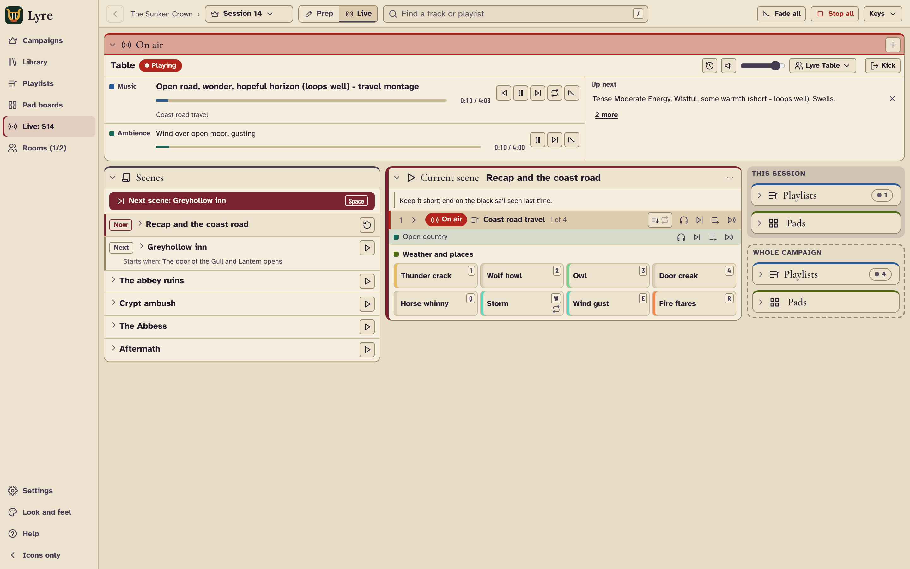

[](https://github.com/nikolaiivanovich38-ship-it/kenku-fm-UI/actions/workflows/ci.yml)
[](https://www.gnu.org/licenses/gpl-3.0)

# Cue Desk

Cue Desk plays your music and sound effects into a Discord voice channel while you run a tabletop role-playing game. It is built for game masters who score their sessions with film soundtracks: playlists for scenes, soundboards for effects, and websites such as YouTube in tabs.

Cue Desk is an **independent fork of [Kenku FM](https://github.com/owlbear-rodeo/kenku-fm)** by Owlbear Rodeo. It is not made or supported by Owlbear Rodeo. "Cue Desk" is a working name and may change; your library will not move if it does.

<p align="center">
  
</p>

## Install (Windows)

1. Open the [Releases page](https://github.com/nikolaiivanovich38-ship-it/kenku-fm-UI/releases).
2. Under the newest release, download the file ending in **`-win32-x64-setup.exe`**.
3. Run it. The app installs and opens by itself.

The installer is not code-signed yet, so Windows may say **"Windows protected your PC"**. Choose **More info**, then **Run anyway**. Each release lists SHA-256 checksums in `SHA256SUMS.txt` if you want to check the download.

Cue Desk and Kenku FM can be installed side by side. They use separate data folders.

macOS and Linux: there are no ready-made downloads yet. See [For developers](#for-developers) to build one.

## First start: bringing your Kenku FM library across

If Kenku FM has been used on this computer, Cue Desk copies its library the first time it starts: playlists, soundboards, bookmarks, settings (including your Discord bot token) and the window position. This happens once.

- **Close Kenku FM before you start Cue Desk for the first time**, so its library is not being written while it is copied. On Windows, if Kenku FM is still open, Cue Desk says "Kenku FM is still running. Close it and restart Cue Desk to bring your library across." Choose **Quit**, close Kenku FM, then start Cue Desk again. (On macOS and Linux Cue Desk cannot tell whether Kenku FM is open, so close it yourself.)
- If the copy goes wrong, Cue Desk tells you and offers to quit; the next time it starts, it tries again. If you choose to start with an empty library instead, the Kenku FM library will not be copied later.
- Kenku FM's own files are only read, never changed or deleted. Kenku FM keeps working as before.
- Your audio files are not copied. Playlists point to the files where they already are, so leave them in place.
- Nothing is copied if Cue Desk already has a library of its own.

Where the libraries are kept on Windows:

| App | Folder |
| --- | --- |
| Kenku FM | `%APPDATA%\Kenku FM` |
| Cue Desk | `%APPDATA%\cue-desk` |

(On macOS: `~/Library/Application Support/`; on Linux: `~/.config/`.)

**If your library did not appear**, and you have not added anything in Cue Desk yet: close Cue Desk, paste `%APPDATA%` into the File Explorer address bar, delete the `cue-desk` folder, close Kenku FM, then start Cue Desk again. Once the copy has succeeded (or there was nothing to copy), the result is written to `data-carry-over.json` in the `cue-desk` folder. It lists folder names only, no personal details; attach it if you report a problem.

## Connect your Discord bot

Cue Desk joins your voice channel as a Discord bot that you create once, for free.

1. Create the bot and invite it to your server by following Owlbear Rodeo's guide, [Getting a Discord token](https://kenku.fm/docs/getting-a-discord-token) (from the Kenku FM documentation, which applies to Cue Desk unchanged).
2. In Cue Desk, open **Settings** (the gear icon), paste the token under **Discord**, and choose **Connect**.
3. Choose your voice channel under **Output**.

Treat the token like a password. Anyone who has it can control your bot.

## Updates

On Windows, Cue Desk checks this project's [Releases](https://github.com/nikolaiivanovich38-ship-it/kenku-fm-UI/releases) every 15 minutes. When an update has downloaded, a message says **"Update Available. Restart to apply."** Cue Desk never installs updates from Kenku FM. Your version number is shown at the bottom of Settings.

## Known limitations

- Sites that use copy protection (DRM), such as Spotify, do not play in tabs. Upstream Kenku FM is built on a special version of Electron that supports it; Cue Desk uses the standard version, which receives security updates for longer.
- The player's background pictures are blank. Upstream's pictures are kept in a private repository.

## Help

- Something wrong? [Open an issue](https://github.com/nikolaiivanovich38-ship-it/kenku-fm-UI/issues). Please do not contact Owlbear Rodeo about this fork.
- Most features work as described in the [Kenku FM documentation](https://www.kenku.fm/docs), including [remote control from a Stream Deck](https://www.kenku.fm/docs/using-kenku-remote).
- What changed in each version: [CHANGELOG.md](CHANGELOG.md).

## For the project owner

- **GitHub Actions must be enabled on the fork**: open the repository's **Actions** tab and confirm. After that, every push is checked (tests, security scans) and the results show on the Actions tab and on pull requests.
- **Making a release**: change `version` in `package.json` (for example `0.1.1`), add the changes to `CHANGELOG.md`, then push a tag with the same number (`v0.1.1`). The Release workflow builds the Windows installer and puts it in a **draft** under **Releases**. Work through [docs/RELEASE_CHECKLIST.md](docs/RELEASE_CHECKLIST.md), then press **Publish release**. Only published releases reach users and automatic updates.

## For developers

Cue Desk is an [Electron](https://www.electronjs.org/) app written in TypeScript and React, built with [Electron Forge](https://www.electronforge.io/) and [Yarn 1](https://classic.yarnpkg.com/).

```sh
yarn             # install
yarn start       # run in development
yarn check       # type check, lint and all tests
yarn make        # build installers into out/make
```

- [docs/DEVELOPING.md](docs/DEVELOPING.md): set-up, scripts, tests, releases, renaming the app.
- [docs/ARCHITECTURE.md](docs/ARCHITECTURE.md): how the app is put together.
- [docs/RELEASE_CHECKLIST.md](docs/RELEASE_CHECKLIST.md): what every release must pass.
- [.github/CONTRIBUTING.md](.github/CONTRIBUTING.md): how to propose a change.

## Licence and credits

Cue Desk is licensed under the GNU General Public License v3.0, the same as Kenku FM. See [LICENSE](LICENSE) and [NOTICE](NOTICE).

Kenku FM was created by [Owlbear Rodeo](https://www.owlbear.rodeo). Thank you for building it and releasing it as open source.
