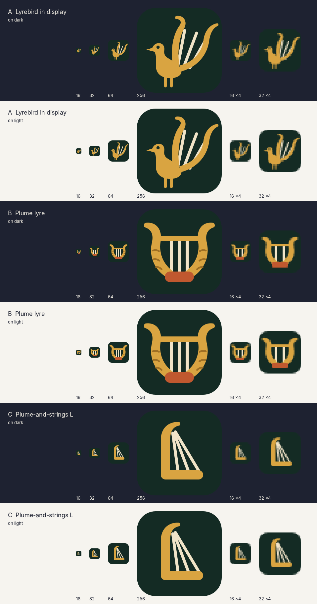

# Lyre: name, logo and colours

The lyrebird is a superb mimic whose song copies every sound around it, which suits an app that plays any sound into Discord. The male's two outer tail feathers curve into the shape of a lyre, and Lyre's logo is that lyre: its arms are the two plumes, banded as the real feathers are, with three strings between them.



Concept B (the plume lyre, middle rows) was chosen over A (a lyrebird in display) and C (an L of plume and strings): it is the only one that still reads as itself at 16 pixels, it is symmetrical and calm in a taskbar full of other icons, and it says "music" before it says "bird", while the banded plumes keep the lyrebird in it.

## Files

All in `src/assets/brand/`:

| File | What it is |
| --- | --- |
| `logo.svg` | The logo, on its rounded tile. Use from 48 pixels up. |
| `logo-small.svg` | The same logo redrawn for 16 to 32 pixels: thicker plumes, two strings, no bands, edges on the pixel grid. |
| `wordmark.svg` | Logo and the word "Lyre" in ivory, for dark backgrounds. |
| `wordmark-on-light.svg` | The same with the word in fern night, for light backgrounds. |
| `concept-a.svg`, `concept-b.svg`, `concept-c.svg` | The three concepts, kept for reference. `concept-b.svg` is `logo.svg`. |

The word uses Lora SemiBold (SIL Open Font License 1.1), stored as outlines, so no font file is needed.

## Colours

| Name | Hex | Used for |
| --- | --- | --- |
| Fern night | `#142B24` | The tile behind the logo; the installer animation's background. The lyrebird lives in fern gullies. |
| Brass | `#D9A441` | The plumes and the crossbar: an old brass instrument under candlelight. |
| Brass shade | `#9E6F24` | The bands across the plumes (large sizes only). |
| String ivory | `#F1E4C8` | The strings; the word "Lyre" on dark backgrounds. |
| Rufous | `#C0582F` | The sound box, after the male lyrebird's rufous throat. Accent only, never text. |

Contrast on fern night: brass 6.7:1, string ivory 11.9:1, rufous 3.3:1 (a shape, not text). Fern night on a light page is 13.6:1. The tile is about as dark as the app's own background (`#1e2231`), so in the app the brass and ivory make the logo stand out (7:1 and better against that background).

The app's interface colours (purple accents from Kenku FM) are not changed by the rename; moving the interface onto this palette is part of the interface redesign.

## Making the icons again

After changing `logo.svg`, `logo-small.svg` or the word, run from the project folder (Linux or WSL with `rsvg-convert`, Python 3, Pillow and fontTools):

```sh
python3 scripts/brand/wordmark.py           # wordmark.svg and wordmark-on-light.svg from logo.svg
python3 scripts/brand/generate_assets.py    # every icon and installer image below
python3 scripts/brand/concept_sheet.py      # docs/brand-concepts.png
yarn test:scripts                            # checks sizes and formats
```

`generate_assets.py` writes into `src/assets/`: `icon.svg` (a copy of `logo.svg`, shown in the window), `icon.png` and `icons/<n>x<n>.png` (16 to 1024; 32 and below from `logo-small.svg`), `icon.ico` and `setup.ico` (16 to 256, each size drawn separately), `icon.icns` and `setup.icns` (macOS is not a target yet, but the build names them), `player-icon.png` (the player tab), `loading.gif` (shown by the Windows installer while it installs: the three strings are plucked one after another, then rest) and `dmg-background.png` (macOS disk image, not used yet). These tools are needed only to change the artwork; the results are committed, so building the app does not need them.

## Using the logo

Do:

- Use `logo.svg` with its tile, at 48 pixels or more, and `logo-small.svg` below that.
- Use `wordmark.svg` on dark backgrounds and `wordmark-on-light.svg` on light ones.
- Leave clear space around the tile of at least a quarter of its width.
- Name the app "Lyre", with a capital L, in text.

Don't:

- Take the lyre off its tile and put it on a light background: brass on white is too faint.
- Recolour it, add gradients, shadows or outlines, or stretch it.
- Swap the rufous sound box for another colour, or use rufous for text.
- Write the word "Lyre" in another typeface beside the logo; use the wordmark files.
- Use Kenku FM's bird or Owlbear Rodeo's artwork anywhere in Lyre: they are not ours.
