# Data model

The library database (backlog DAT-6, DAT-1, DAT-2, DAT-10, DAT-11, ORG-4, ORG-7, ORG-1, EDT-2). It lives in the main process, in `src/main/data/`. Schema version 1 (`schema/v001-library.ts`) is the agreed design (Lyre design round 4, `design/prototype`), normalised for this app's read paths; the steps written in waves 1 and 2 were folded into it before any release (DB review 8), so no conversion from an older format exists. Nothing uses it yet: the current player keeps its own storage until your existing library is moved across (DAT-9) and the new interface (wave 3) uses the database.

## In plain language

### What is stored

- **Your library of tracks.** Every audio file appears once, as a track, whether or not it is in a playlist. A track is music, ambience or a sound effect, and has up to three names: the title you give it (it may be empty at first), the title in the file's tags, and the file name; Lyre shows the first one it has. It keeps your scoring details if you fill them in: energy (1 to 5), what it is for (loop bed, underscore, sting, transition, effect), whether it loops (yes, with a crossfade, no), how it develops and ends, notes, artist, album, rating and when it was last played.
- **How a track sounds (its audio profile).** Where it starts and ends, what happens at the end (loop, next, stop), where a loop starts and how long its crossfade is, fades in and out with their shape, and named points. A track can also sound different inside one playlist, in one scene or (version 3) in one session's list; that version is used there only.
- **Markers** inside a track: a time, a kind (plain marker, or mix out: where the next track may start) and a label such as "swell". You can search for them. Where a loop starts and ends belongs to the track's audio profile, so it is kept in one place.
- **Tags in groups.** A new library starts with Mood (with Melancholy, Heroic, Tense, Wistful, Warm, Triumphant and Eerie), Leitmotif and Scene type. You can add, rename, reorder, merge or delete any of them. A tag can sit under another (Leitmotif › Villain › Strahd) and can have other names ("sad" finds Melancholy).
- **Playlists.** Each plays into one lane: Music, Ambience or FX. A manual playlist lists tracks you picked, in your order, with optional headings. A dynamic playlist has a rule instead (for example "Mood any of Eerie, Dread; energy 0 to 3; no stings") and always plays every track in its lane that matches. Renaming a tag changes it in every rule; deleting a tag takes it out of every rule, and a condition left with no tags plays nothing (it never widens to the whole lane). Before you delete a tag, Lyre can show where it is used: how many tracks carry it, which rules name it and which pads play it.
- **Pad boards.** A grid of 1 to 8 columns and rows. Each pad has a label, an icon, a colour, a key, a way of playing (once, toggle, hold, restart) and a sound: one file, several variants (at random or in turn), or any effect with a tag. Changing the grid's size packs the pads left to right, top to bottom; only pads that do not fit go to "Spare pads", and they come back when the grid grows. A pad you put in Spare pads yourself stays there. Nothing is deleted, and undo puts every pad back.
- **Play order** (version 3). How a playlist plays: shuffled or in order, and no repeat, repeat all or repeat one. A playlist has its own order, and a scene, a session's list or a campaign's list can have its own for that playlist, used only there.
- **A track's name in a scene** (version 3), such as "Strahd's entrance": shown in that scene only, and found by search.
- **Track shape** (version 3): steady, builds, falls away, peaks then falls, or rises and falls. Lyre suggests one from the track's loudness; your choice wins.
- **Tracks on hand** (version 3): single tracks a campaign or a session keeps beside its playlists.
- **Repeat one in a scene** (version 5): a track of a scene (or of one of its playlists) that plays again when it ends, every time the scene plays. It goes with the scene or the track. The Repeat button on the Now playing bar and in Live's On air is not stored at all: it lasts while that room's music plays.
- **A playlist's order in one place** (version 5): its tracks dragged into another order in one scene, one session's list or one campaign's list, used only there. Tracks added to the playlist later come after them; "Back to the playlist's order" removes it. The order of the playlists in a session's or campaign's list was already kept (version 1).
- **Round 7 (version 6).** Tag groups, tags and folders can have a colour from the pad colours. A pad board can name a row of pads ("Spells"). A scene's start and a pad can do their own steps (play, stop, fade the music, wait, fire a pad, start a scene); a scene can start the next one by itself. A track can say what follows it when it ends, start again where it was stopped, and fade out at its end; one marker of an audio profile can be where the next track comes in. The keys you changed, the crossfade between tracks and Next scene's guard are kept with the library. Pads are found by Find and play.
- **Campaigns, sessions and scenes.** A campaign has a look (theme), a game system, a description and (for later) its Obsidian notes, and the playlists and boards you use all campaign long. A session has a number (counted from the campaign's first session number in session order, so moving a session renumbers them all, as the prototype does), a name, a date, a status (played, next, draft; only one "next" per campaign) and its own playlists and boards. A scene has a name, a "starts when" line, notes, a music list (tracks and playlists in any mix, in playing order), one ambience track or playlist, and its pad boards.
- **Folders** for playlists, boards and sessions, inside each other as deep as you like.
- **Keys** (hotkeys) and what each runs: play a track or playlist, start a scene, next, previous, fade a lane, fade or stop everything, press a pad, undo a scene start, in order. Deleting a track, playlist, scene or pad takes it off every key.
- **How loud each track is across its length** (its wave): about 1,000 loudness levels per track, worked out by Lyre from the file in the background after you add it (or when a screen first shows the track), and worked out again if the file changes. It goes when the track goes; undo brings the track back and Lyre works its wave out again. If a file cannot be read, Lyre remembers that and does not keep trying until the file changes.

The audio files themselves are not copied: they stay where they are, and each track remembers where its file is. A file is in the library once: the same file cannot become two tracks, whatever the letter case or slash direction. You can name a library folder (for example "Soundtracks" = `H:\Audio\Soundtracks`); tracks inside it, including tracks added before the folder was named, are remembered relative to it, so moving it to another drive needs one change. A folder can be watched, so new files in it are added by themselves.

Deleting a playlist or a board never deletes tracks. Deleting a track, playlist or board takes it out of every playlist, pad, scene, session and campaign that uses it; the interface shows where it is used and asks first, and undo puts everything back.

### How the library is built, in short

Every fact is kept in one place: a track's name is stored once, so changing it changes it everywhere. Lists you put in order (a scene's music, a playlist, a campaign's boards) are stored as rows with their place in the list. The database itself refuses values that make no sense (an energy of 7, an unknown lane, two "next" sessions in a campaign, a fade shape over 100, an end before the start), so a mistake anywhere in Lyre cannot damage your library. It keeps indexes, like the index of a book, for each thing Lyre looks up often, and tests check that every frequent question uses one.

### Where it is

| What | Where on Windows |
| --- | --- |
| The library | `%LOCALAPPDATA%\Lyre Library\library.sqlite` (Local, not Roaming: on managed Windows, Roaming can be moved to a network share; and not `%LOCALAPPDATA%\lyre`, the program's own folder, which uninstalling deletes) |
| Working files of the library, present while Lyre runs | `library.sqlite-wal`, `library.sqlite-shm` next to it. They are part of the library: do not delete them. The `-wal` file is kept to 8 MB at most after use. |
| Backups | `%LOCALAPPDATA%\Lyre Library\backups\` |

If the folder is on a network share anyway, Lyre still works there, with a slower but safe way of saving (a rollback journal instead of the write-ahead log).

### Backups

Copies are made in the background, so music and effects on Discord never stutter while one is made.

- **Daily:** the first time Lyre runs on a day, it makes a copy two minutes after it starts, and while it stays open it checks every hour whether a new day has started. The newest 14 daily copies are kept.
- **Back up now:** a button in the new interface makes a copy at once. The newest 14 of these are kept, separately.
- **Before an upgrade:** when a new version of Lyre changes the library format, it copies the library first.
- **Before your old library moves in:** the first time the new interface starts, Lyre copies the library before it brings in the old player's playlists and soundboards (`library-before-import-…`).

Every copy is checked before it counts, and a damaged copy is never put back. Names show the kind and the time, for example `library-daily-2026-11-04T12-00-00-000.sqlite`.

### If the library file is damaged

Each time Lyre opens the library it runs SQLite's quick check alongside start-up. If the file is damaged, Lyre says so in plain words and offers to put back the newest backup that passes the same check. The damaged file is kept, renamed `library-damaged-<time>.sqlite`.

### Undo

Every change to the library, tags, playlists, boards, folders, campaigns and keys can be undone and redone, including deletes and changes that touch many rows (resizing a board, merging two tags, deleting thousands of tracks). The last 100 steps are kept while Lyre is open, and at most 64 MB of them (the newest step is always kept). Adding files or moving the old library in clears the undo list, because older steps could clash with what was added.

### Big changes while you play

Discord's sound is fed from the same part of Lyre as the library, from a queue that holds a fifth of a second. So a big change (tagging or deleting thousands of tracks, deleting a tag group, relinking a moved folder, and undoing any of these) is saved a few hundred tracks at a time, with the sound fed in between; it is still one step to undo. While it runs, a progress bar shows and other edits wait; a search may miss a renamed tag on some tracks for a moment.

### Adding tracks, and your old library (import stream)

- **Add files or a folder.** Every audio file in it (subfolders too) becomes a track marked **New**; hidden and Windows system folders are skipped, and a file already in your library is never added twice (letter case ignored). Its kind comes from its folder: Ambience, Atmospheres or Beds give ambience; Effects, SFX or Foley give a sound effect; anything else music. Its title in the file, artist, album and length come from the file's tags (read by music-metadata); your own title is never touched. Afterwards Lyre works out each new track's wave in the background, one track at a time, without slowing anything you play. The New mark goes once the track has a title of your own and a tag. A progress bar follows the work, Stop keeps what was saved, and the result says in plain words what was added and what was not.
- **Your old library moves in once.** Playlists and soundboards from the old player keep their names, order, pictures and sound settings; a file used in several places becomes one track, everywhere it was. Files that cannot be found still move (so playlists stay whole) and are listed. A copy of the library is made first, the old player's own library is never changed, and if Lyre stops halfway it carries on next time.
- **Find missing files.** Lyre lists tracks whose files have gone and looks for them in a folder you choose, by name, size and content; you confirm, and one Undo puts everything back.
- **Suggestions from your titles.** "Melancholy tense - harbour at night (loops well)" suggests Melancholy and Tense, and "loops well". Nothing is applied until you accept.

### Upgrades

A newer version of Lyre may change the library format. The upgrade happens by itself when it starts, after the backup above. If it fails, the library stays exactly as it was. A library from version 1 (wave 1) comes through version 2 without losing anything: its soundboard sounds become pads (a sound that looped becomes a toggle pad), and its scene material is split into the music list and the boards. The only thing with no place in the new design is the label of a divider on a soundboard; a divider starts a new row of pads instead.

### How fast it is

Measured with 20,000 tracks, 500 playlists and 3 campaigns of 50 sessions with 8 scenes each (a 40 MB library) on the 2-core build machine, warm cache: opening about 7 ms; a search 0.02 to 4 ms; loading a whole campaign about 3 ms (all three about 9 ms); working out a dynamic playlist up to 6 ms; finding where something is used under 1 ms; a single edit under 0.5 ms; an edit plus its undo about 1.2 ms; a backup about 0.2 s, on a worker thread (it holds the main process 4 ms). No bulk change or undo holds the main process longer than about 100 ms of processor time (150 ms by the clock): tagging 10,000 tracks, deleting 5,000 tracks or a tag group, merging tags, relinking 3,000 files, adding or removing a library folder of 20,000 tracks, and undoing and redoing each.

## Technical reference

### Module layout

| File | Purpose |
| --- | --- |
| `sqlite.ts` | Loads `node:sqlite` (decision D3) without its experimental warning; `openConnection()` turns on foreign keys, recursive triggers, `temp_store = MEMORY` and, for files, WAL with `synchronous = NORMAL` (or a rollback journal with `FULL` where WAL cannot work). |
| `schema/migrate.ts`, `schema/index.ts`, `schema/v001-library.ts`, `schema/v002-peaks.ts`, `schema/v003-round5.ts`, `schema/v004-loudness.ts`, `schema/v005-round6.ts`, `schema/v006-round7.ts` | Numbered schema versions (six so far: the library, loudness peaks, design round 5, volume normalisation, design rounds 6 and 7), the upgrade runner (`MigrationContext.startVersion` tells a step whether the library is new) and `rebuildTable()` (with `withoutRowid` for link tables). |
| `store.ts` | `Store`: prepared statements (the 200 most recently used), injected clock, `change(label, fn)` (one transaction, one undo step), `changeInBatches(label, items, fn)` (bulk work, one undo step), `exclusive()`, `changeWithoutHistory(fn)` (clears the history), `busyWith`, `searchCaughtUp()`. |
| `searchIndex.ts` | Temporary triggers that mark changed tracks, and `flushSearchIndex` (each marked track's search entry rebuilt once, before COMMIT). |
| `ordering.ts` | Gap ordering (`positionFor`, `positionsFor`, `assignPositions`). |
| `validate.ts`, `designValidate.ts`, `errors.ts`, `types.ts` | Input checks (`designValidate` for audio profiles and rules, mirroring the tables' CHECKs), error classes, data-layer types. |
| `repo/*.ts` | Repository functions: `roots`, `tracks`, `markers`, `folders`, `playlists` and `boards` (both on `containers`), `tags`, `campaigns`, `profiles`, `cueActions`, `search`; `domain` maps rows to the shared shapes of `src/common/domain`. `profileRows` and `ruleRows` store profiles and rules as rows (used inside other modules' changes); `peaks` reads and saves a track's loudness peaks (`trackPeaks`, `savePeaks`). Version 3: `playOrders` (PLY-13), `sceneNames` (DAT-14), `places` (checks a scene, session or campaign place and names it as a key). Version 5: `round6` (PLY-17 Repeat one, ORG-13 track order per place). Version 6: `round7` (board dividers, steps, moving on, how a track plays, tags inside tags, shortcuts and play settings). |
| `peaks.ts` | `PeakJobs`: works out loudness peaks one track at a time through a `PeakReader` (the real one runs ffmpeg: `src/main/media/ffmpegPeaks.ts`); on demand first, then after imports. |
| `undo.ts` | `UndoHistory` (100 steps and 64 MB at most; a large step is replayed 500 rows at a time); `Store.clearHistory()` empties it. |
| `import/*.ts` | Bringing audio in: `audioFiles` (which files, walking folders), `kindGuess`, `fileFacts` (quick checksum), `tagReader` (DAT-5, behind an interface), `musicMetadata` (the real reader; only the library's process imports it), `pipeline` (EDT-6 `importAudio`, `refreshEmbeddedTags`), `legacy` (DAT-9), `relink` (DAT-8), `titleTags` (DAT-4). |
| `integrity.ts`, `backups.ts`, `library.ts` | Integrity check and `runInWorker()` (eval worker threads), backups (`backUpInBackground` on a worker), `openLibrary()`, `libraryFolder()`, `isNetworkPath()`, `restoreBackup()`, `startDailyBackups()`. Opening and closing run `PRAGMA optimize` so the planner's statistics stay current. |
| `index.ts` | Public exports. |

### Design rules

1. **Third normal form by default.** One fact in one place; no lists inside a column. Ordered relations are join tables with a `position` that is UNIQUE within its list. A reference that may be one of two things (a scene's music item is a track or a playlist) is two nullable foreign keys with a CHECK that exactly one is set, so foreign keys and ON DELETE rules apply.
2. **JSON only for self-contained values the database never queries.** The one use left: a long job's own record (`library_jobs.detail`, checked with `json_valid`). Rules, profiles, pad sounds and cue actions are rows.
3. **Integrity in the schema.** Foreign keys with explicit ON DELETE; CHECK constraints for every list of choices and every range; UNIQUE natural keys and positions; a partial unique index for "one next session per campaign"; triggers only for rules that span two tables. The repository checks the same rules first, to report them in plain words.
4. **An index per read path**, named in the schema next to the path it serves and checked by `queryPlan.test.ts`.
5. **Denormalise only with a measured reason**, kept correct by triggers and covered by tests (see "Deliberate exceptions").

Every list of choices is a CHECK; a later choice is added with `rebuildTable` (which keeps every row) in a new step. That costs a short migration step per new choice, which the integrity is worth.

### Entity-relationship diagram

```mermaid
erDiagram
  library_roots ||--o{ tracks : "files under"
  tracks ||--o{ markers : has
  tracks ||--o{ track_follow_with : "followed by"
  tracks ||--o{ track_tags : tagged
  tag_groups ||--o{ tags : contains
  tags ||--o{ tags : "parent of"
  tags ||--o{ tag_synonyms : "also called"
  tags ||--o{ track_tags : on
  tracks ||--o{ audio_profiles : "sounds like"
  audio_profiles ||--o{ audio_profile_markers : "named points"
  playlists |o--o{ audio_profiles : "override in"
  scenes |o--o{ audio_profiles : "override in"
  folders ||--o{ folders : contains
  folders |o--o{ playlists : contains
  folders |o--o{ boards : contains
  folders |o--o{ sessions : groups
  playlists ||--o{ playlist_items : "manual entries"
  tracks |o--o{ playlist_items : in
  playlists ||--o{ rule_conditions : "dynamic rule"
  tag_groups ||--o{ rule_conditions : "looked at by"
  rule_conditions ||--o{ rule_condition_tags : names
  tags ||--o{ rule_condition_tags : "named in"
  boards ||--o{ pads : "grid and spare"
  pads ||--o{ pad_sounds : plays
  tracks ||--o{ pad_sounds : "played by"
  tags |o--o{ pads : "played by tag"
  campaigns ||--o{ sessions : contains
  sessions ||--o{ scenes : contains
  campaigns ||--o{ campaign_playlists : uses
  playlists ||--o{ campaign_playlists : "used by"
  campaigns ||--o{ campaign_boards : uses
  boards ||--o{ campaign_boards : "used by"
  sessions ||--o{ session_playlists : uses
  playlists ||--o{ session_playlists : "used by"
  sessions ||--o{ session_boards : uses
  boards ||--o{ session_boards : "used by"
  scenes ||--o{ scene_music : "plays in order"
  tracks |o--o{ scene_music : item
  playlists |o--o{ scene_music : item
  scenes ||--o| scene_ambience : ambience
  tracks |o--o{ scene_ambience : item
  playlists |o--o{ scene_ambience : item
  scenes ||--o{ scene_boards : "boards in order"
  boards ||--o{ scene_boards : "used by"
  tracks |o--o{ cue_actions : plays
  playlists |o--o{ cue_actions : plays
  scenes |o--o{ cue_actions : starts
  pads |o--o{ cue_actions : presses
  sessions |o--o{ audio_profiles : "override in"
  playlists ||--o{ play_orders : "plays as"
  scenes |o--o{ play_orders : "order in"
  sessions |o--o{ play_orders : "order in"
  campaigns |o--o{ play_orders : "order in"
  scenes ||--o{ scene_track_names : "names"
  tracks ||--o{ scene_track_names : "named in"
  playlists ||--o{ rule_shapes : "asks for"
  campaigns ||--o{ campaign_tracks : "keeps on hand"
  tracks ||--o{ campaign_tracks : "on hand in"
  sessions ||--o{ session_tracks : "keeps on hand"
  tracks ||--o{ session_tracks : "on hand in"
  scenes ||--o{ repeat_ones : "repeats"
  tracks ||--o{ repeat_ones : "repeated in"
  playlists ||--o{ track_orders : "ordered in"
  scenes |o--o{ track_orders : "order in"
  sessions |o--o{ track_orders : "order in"
  campaigns |o--o{ track_orders : "order in"
  track_orders ||--o{ track_order_items : "tracks in order"
  tracks ||--o{ track_order_items : "placed in"
```

`schema_migrations`, `library_jobs`, `search_docs`, `search_fts` and `track_peaks` (one row per track, CASCADE) are bookkeeping and derived data, not shown.

### Tables

Conventions: text ids (UUIDs; ids from older data can be kept); times in milliseconds since 1970 UTC; durations and points in a track in milliseconds; `position` is a REAL gap order key, UNIQUE within its list, never defaulted. Every table has a primary key (undo depends on it); link and list tables whose key is their columns are `WITHOUT ROWID`. "NF" is the highest normal form the table meets.

| Table | Purpose | Key; other unique keys | Constraints | NF |
| --- | --- | --- | --- | --- |
| `library_roots` | Named library folders; `watched` 0/1 | `id`; `name` (any case) | | BCNF |
| `tracks` | One row per audio file; `shape` (version 3) the game master's choice, NULL to follow the suggestion | `added_seq` (INTEGER, AUTOINCREMENT: library order); `id`; the file: (`root_id`, `path`) any case, else `path` any case, else `url` (three partial unique indexes) | `kind` music/amb/fx; `role` loop_bed/underscore/sting/transition/effect; `loopable` yes/crossfade/no; `arc`, `ending` lists; energy and rating 1–5; sizes and durations ≥ 0; exactly one of `path`/`url`; `root_id` only with `path`; `is_new` 0/1; `root_id` RESTRICT | 3NF (exception 3) |
| `markers` | Named, typed points in a track (DAT-3), searchable | `id` | `kind` marker/mix_out (loop points are the profile's); time ≥ 0; track CASCADE | BCNF |
| `track_follow_with` | "Follow with" suggestions, in order | (`track_id`, `follow_track_id`); (`track_id`, `position`) | not itself; both CASCADE | BCNF |
| `folders` | Nested folders | `id`; (`scope`, parent, `position`) | `scope` playlists/boards/sessions; colour `#rrggbb`; parent SET NULL (the repository moves contents up first) | BCNF |
| `playlists` | Playlists; a dynamic one's rule settings | `id`; (folder, `position`) | `kind` manual/dynamic; `lane` music/amb/fx; energy range 0–5, both or neither, min ≤ max; rule settings only on a dynamic playlist; `kind` never changes (trigger) | 3NF |
| `playlist_items` | A manual playlist's entries | `id`; (`playlist_id`, `position`) | `kind` track/divider; a track entry has a track and a divider none; CASCADE; manual playlists only (trigger) | BCNF |
| `rule_conditions` | A dynamic playlist's conditions, in order | `id`; (`playlist_id`, `position`); (`id`, `group_id`) as a key target | `match` any/all/none; playlist and group CASCADE; dynamic playlists only (trigger) | BCNF |
| `rule_condition_tags` | The tags a condition names, in order | (`condition_id`, `tag_id`); (`condition_id`, `position`) | (`condition_id`, `group_id`) → `rule_conditions` and (`group_id`, `tag_id`) → `tags`, both CASCADE: a value is always a tag of the condition's group | 1NF by design (exception 2) |
| `boards` | Pad boards | `id`; (folder, `position`) | `grid_cols`, `grid_rows` 1–8 | BCNF |
| `pads` | Pads: in one cell or spare; `put_aside` (version 3) a spare pad the game master put there by hand | `id`; (`board_id`, `grid_row`, `grid_col`) (NULL cells of spare pads never clash); (`board_id`, `spare_position`) when spare | cell 0–7; on the grid or spare, never both or neither; `color`, `mode`, `sound_kind`, `sound_order` lists; `icon` a short name; `hotkey` one lower-case key or `f1`–`f12`; volume 0–1; fades ≥ 0; board CASCADE; tag SET NULL (the pad stays) | 3NF |
| `pad_sounds` | The tracks a pad plays, in order | (`pad_id`, `track_id`); (`pad_id`, `position`) | both CASCADE | BCNF |
| `tag_groups`, `tags`, `tag_synonyms`, `track_tags` | Tag vocabulary and tagging (DAT-10) | group `name`; tag (`group_id`, `name`); positions; (`group_id`, `id`) as a key target | parent SET NULL; CASCADE from group and tag | BCNF |
| `campaigns` | Campaigns | `id`; `position` | `theme` fern/hearth/candle/parchment/elysium (default candle); colour `#rrggbb`; `first_session_number` 0–100,000 (default 1) | BCNF |
| `sessions` | Sessions (their number is derived: see "Notes on choices") | `id`; (`campaign_id`, `position`); one `status = 'next'` per campaign (partial unique index) | `status` played/next/draft; date `YYYY-MM-DD`; campaign CASCADE | BCNF |
| `scenes` | Scenes | `id`; (`session_id`, `position`) | session CASCADE | BCNF |
| `campaign_playlists`, `campaign_boards`, `session_playlists`, `session_boards` | What a campaign or session uses, in order | (owner, item); (owner, `position`) | both CASCADE | BCNF |
| `scene_music` | A scene's music in playing order; an item may come twice | `id`; (`scene_id`, `position`) | exactly one of `track_id`/`playlist_id`; all CASCADE | BCNF |
| `scene_ambience` | A scene's one ambience item (no row: none) | `scene_id` | exactly one of `track_id`/`playlist_id`; all CASCADE | BCNF |
| `scene_boards` | A scene's boards in order | (`scene_id`, `board_id`); (`scene_id`, `position`) | both CASCADE | BCNF |
| `audio_profiles` | A track's own profile (no place) or its override in one playlist, one scene or (version 3) one session list; a NULL setting means the default | `id`; partial unique: `track_id` (own), (`playlist_id`, `track_id`), (`scene_id`, `track_id`), (`session_id`, `track_id`) | at most one place; `after_end` loop/next/stop; times ≥ 0; fade length and shape both or neither, shape 0–100; start < end; start ≤ loop start < end; all CASCADE | BCNF |
| `audio_profile_markers` | A profile's named points, in order | (`profile_id`, `position`) | time ≥ 0; CASCADE | BCNF |
| `cue_actions` | What a hotkey runs, in order (PLY-8 `CueAction`) | `id`; (`hotkey`, `position`) | `type` one of ten (not `removeQueued`, a live queue entry); exactly the columns its type needs (CHECK per column); `hotkey` lower case; `lane`, `play_when`, `phase` lists; `fade_ms` 0–60,000; track, playlist, scene, pad CASCADE; "picked from" playlist and scene SET NULL | BCNF (exception 6) |
| `library_jobs` | Long jobs that run once and survive a crash: name, state running/done, JSON detail | `name` | `state` running/done; `detail` `json_valid` | BCNF |
| `search_docs`, `search_fts` | Search index (derived) | `doc_id`; (`kind`, `ref_id`) | written only by triggers | derived copy (exception 1) |
| `track_peaks` | A track's loudness peaks (version 2): the file's size and modified time they were worked out from, `suggested_shape` (version 3, kept ahead of the levels), `levels` (BLOB, one byte per point, 0 = -60 dBFS or quieter, 255 = full scale; NULL: the file could not be read), when | `track_id` (`WITHOUT ROWID`) | `levels` NULL or a BLOB of 1–4,096 bytes; a shape only with levels, one of the five; size ≥ 0; track CASCADE; outside undo | BCNF |
| `play_orders` | Version 3 (PLY-13): how a playlist plays (`shuffle` 0/1, `repeat` off/all/one), its own (no place) or in one scene, session list or campaign list | `id`; partial unique: `playlist_id` (own), (`scene_id`, `playlist_id`), (`session_id`, `playlist_id`), (`campaign_id`, `playlist_id`) | at most one place; all CASCADE | BCNF |
| `scene_track_names` | Version 3 (DAT-14): a track's name in one scene | (`scene_id`, `track_id`) (`WITHOUT ROWID`) | name trimmed, 1–200 characters; both CASCADE | BCNF |
| `rule_shapes` | Version 3 (DAT-13): the shapes a dynamic playlist asks for (none: any) | (`playlist_id`, `shape`) (`WITHOUT ROWID`) | one of the five shapes; dynamic playlists only (trigger); CASCADE | BCNF |
| `campaign_tracks`, `session_tracks` | Version 3 (ORG-12): single tracks on hand, in order | (owner, `track_id`); (owner, `position`) | both CASCADE | BCNF |
| `repeat_ones` | Version 5 (PLY-17): a scene's track with Repeat one on (a row while on) | (`scene_id`, `track_id`) (`WITHOUT ROWID`) | both CASCADE | BCNF |
| `track_orders` | Version 5 (ORG-13): a playlist's track order in exactly one place (scene, session list or campaign list) | `id`; partial unique: (`scene_id`, `playlist_id`), (`session_id`, `playlist_id`), (`campaign_id`, `playlist_id`) | exactly one place (CHECK); all CASCADE | BCNF |
| `track_order_items` | Version 5 (ORG-13): the tracks of one order, each once, in order | (`order_id`, `track_id`) (`WITHOUT ROWID`); (`order_id`, `position`) | both CASCADE (a deleted track drops out) | BCNF |
| `board_dividers` | Version 6 (ORG-4): a name above a row of a pad board | (`board_id`, `grid_row`) (`WITHOUT ROWID`) | row 0–7; name trimmed 1–200; board CASCADE | BCNF |
| `cue_lists` | Version 6 (PLY-8): one scene's or one pad's own steps (no row: the usual) | `id`; `scene_id` UNIQUE, `pad_id` UNIQUE | exactly one owner (CHECK); both CASCADE | BCNF |
| `cue_steps` | Version 6 (PLY-8): a list's steps in order | `id`; (`list_id`, `position`) | `action` one of ten; exactly the columns its action needs (a CHECK per column); level 0–1; fade ≤ 60 s, wait ≤ 10 min; list, track, playlist, board, pad, scene CASCADE | BCNF |
| `scene_moves_on` | Version 6 (PLY-8 Then): a scene that starts the next by itself | `scene_id` (`WITHOUT ROWID`) | `musicEnds` or `after` with `after_ms` 1 s–6 h (CHECK both or neither); CASCADE | BCNF |
| `track_follows` | Version 6 (SHW-3): what plays when a track ends | `track_id` (`WITHOUT ROWID`) | exactly one of a track or a playlist, never itself; all CASCADE | BCNF |
| `shortcut_keys` | Version 6 (UX-12): keys the game master changed | `action` (`WITHOUT ROWID`); `key` any case | action one of `SHORTCUT_ACTIONS`; key 1–40 | BCNF |
| `schema_migrations` | Applied versions | `version` | | |

#### Notes on choices

- **Polymorphic references.** `scene_music`, `scene_ambience` and `audio_profiles` (its place) use two nullable foreign keys and a CHECK instead of a "kind + id" pair, so deleting a track or playlist removes those rows by ON DELETE CASCADE and no reference can dangle.
- **Pads in cells or spare.** One table with mutually exclusive columns (enforced by CHECK) keeps a pad's settings in one row wherever it is; moving a pad changes only where it is. Cells are (row, column) rather than one slot number, so resizing a board keeps every pad at its row and column without renumbering.
- **Profiles: NULL means "default".** `resolveProfile` (src/common/domain) fills missing settings from the track; storing NULL keeps "not set" apart from "set to 0". A profile with every setting NULL is a valid override (the track's settings here, with markers of its own, or simply marked "own settings").
- **Profile markers and track markers** are different facts: a track's markers (DAT-3) are typed and searchable; a profile's markers belong to that profile and may differ per place.
- **ON DELETE policy.** CASCADE for rows owned by their parent (a playlist's entries, a scene's items) and for link rows (memberships, uses): the interface shows `listUses`/`trackUsage` and asks before deleting, then the database removes the links in the same undo step, so undo restores them. RESTRICT where deleting would lose what the game master did not see (`library_roots`: `removeRoot()` first turns its tracks' paths into absolute paths). SET NULL where the child stays meaningful (a pad whose tag is deleted; folder parents as a safety net).
- **Unique positions and moves.** Two rows of a list never share a position, even for a moment: renumbering and multi-row moves go through temporary positions (`assignPositions`), and the pad swap through a temporary spare place. Undo replays the same steps backwards, so it never meets a clash either.
- **Session numbers are derived, not stored** (DB review, done in wave 3): `campaigns.first_session_number` plus the number of the campaign's sessions before it in `position` order (the prototype's `renumber`). `listSessions` and `getSession` compute it (`SESSION_SELECT`, served by `sessions_order`); moving or deleting a session renumbers the rest by itself.
- **Library order** is `tracks.added_seq`, the integer primary key: undo puts a deleted track back with its number, VACUUM cannot renumber it, and reading in library order reads the table in key order.
- **One track per file.** The unique indexes compare paths ignoring letter case, as Windows and the import's `fileKey` do; full paths are stored normalised (`normalizePath`: backslashes and no `.` parts on Windows). Adding a library folder takes in the tracks already inside it (their paths become relative), the deepest folder winning, as for new files.

### Normal forms and exceptions

Every table is in third normal form, and all but three in Boyce-Codd normal form: each fact depends on the key, the whole key and nothing but the key, with no lists inside a column. The exceptions below are deliberate, each with a measured reason or a guarantee it buys, and each is kept correct by the schema or by one named piece of code with a test.

### Deliberate exceptions

1. **`search_fts` / `search_docs` (denormalised copy).** FTS5 needs its own copy of the searchable text. Playlists, boards, campaigns, sessions and scenes are kept by triggers in the schema. Tracks are marked by temporary triggers (tracks, tags, synonyms, tagging, markers) and each marked entry is rebuilt once before COMMIT, at most 1,000 per commit with the rest caught up a pass per event-loop turn (`searchIndex.ts`; DB review 5). Covered by `repo/search.test.ts` and `undo.test.ts` (the index is part of every snapshot). Measured reason: a search over 20,000 tracks takes 0.03–14 ms, where matching word starts across the tables would read every track. The `title` column holds the name a track is shown by (title, else file-tag title, else file name), so results need no lookup.
2. **`rule_condition_tags.group_id`** repeats its condition's group (it depends on `condition_id`, part of the key, so the table is not in 2NF). Kept so that two composite foreign keys make "a rule's value is a tag of the condition's group" a guarantee of the schema rather than of the code. It cannot drift: the first key ties it to the condition's group, and a tag moving to another group has its rule rows removed first (`updateTag`).
3. **`tracks.file_name`** is derivable from `path` or `url` (version 1). Kept because relinking moved files and searching need the file name on its own, and a file's base name cannot be computed in SQLite portably. It is written together with the path in one place (`locationColumns` in `repo/tracks.ts`; covered by `repo/tracks.test.ts`), not by a trigger.
4. **Dynamic rule settings on `playlists`.** The energy range and "leave out stings" are facts about the playlist (one each per playlist), so they are its columns; a CHECK keeps them empty on manual playlists. A separate one-to-one rules table would add a join to every read.
5. **`cue_actions.from_step`** is meaningful only with `from_scene_id`; when that scene is deleted (SET NULL) the step stays and is ignored. A CHECK cannot clear it, and losing the whole action for it would be worse.
6. **No cached counts.** Nothing else is stored twice. Counts per playlist or per session were considered and not added: the measured reads (a whole campaign tree in about 5 ms; a list in order is one index search) do not need them.

### Indexes and the read paths they serve

`queryPlan.test.ts` runs EXPLAIN QUERY PLAN on the exact SQL of each path below (exported by its module) and fails on a full table scan or a missing index.

| Read path (query) | Index |
| --- | --- |
| Campaign tree (`campaignTreeQueries`, 10 queries, no sorting step) | `campaigns` primary key, `sessions_order`, `scenes_order`, `campaign_playlists_order`, `campaign_boards_order`, `session_playlists_order`, `session_boards_order`, `scene_music_order`, `scene_ambience` primary key, `scene_boards_order` |
| A scene's music in order, with titles (`SCENE_MUSIC_SQL`) | `scene_music_order`, then tracks and playlists by primary key |
| A manual playlist's tracks in order (`PLAYLIST_ITEMS_SQL`) | `playlist_items_order` |
| Drawing a board: pads and their sounds (`BOARD_PADS_SQL`) | `pads_cell` (also one pad per cell), `pad_sounds` primary key; `pads_spare` keeps one pad per spare place |
| The track list in shown-name order, a page at a time (`trackListQuery`, `listTracks({ after })`) | `tracks_shown_title` (an index on the shown name), read in order, never sorted |
| Finding a track by its file (`TRACK_BY_PATH_SQL`, `findTrackByLocation`; relinking, watched folders); every track under a library folder | `tracks_root_path`, `tracks_absolute_path`, `tracks_url` |
| Where a tag is used (`TAG_USAGE_SQL`, `tagUsage`) | `track_tags_tag`, `rule_condition_tags_tag`, `pads_tag` |
| A hotkey's actions in order (`HOTKEY_ACTIONS_SQL`) | `cue_actions_order`; cascades through `cue_actions_track`, `_playlist`, `_scene`, `_pad`, `_from_playlist`, `_from_scene` |
| Tracks by tag: the library's filter (`tracksWithTagsSql`) | `track_tags_tag`, then tracks by primary key |
| Dynamic playlist with a tag condition (`dynamicTracksQuery`) | `track_tags_tag` for the starting set, `track_tags` primary key per condition |
| Dynamic playlist of energy alone, or only leaving tags out | `tracks_kind` (kind, energy); the FX lane also `tracks_role` (role, energy), as an OR of two index searches |
| Uses of a playlist (`USES_QUERIES.playlist`) | `campaign_playlists_playlist`, `session_playlists_playlist`, `scene_music_playlist`, `scene_ambience_playlist`; its place in a music list via `scene_music_order` |
| Uses of a board | `campaign_boards_board`, `session_boards_board`, `scene_boards_board` |
| Uses of a track | `scene_music_track`, `scene_ambience_track`; also `playlist_items_track`, `pad_sounds_track`, `track_follow_with_target` (`trackUsage`, ON DELETE CASCADE) |
| Profile lookup by (track, place) (`PROFILE_LOOKUP_SQL`) | `audio_profiles_own`, `audio_profiles_playlist`, `audio_profiles_scene`, `audio_profiles_session`; a track's profiles everywhere: `audio_profiles_track` |
| Version 3: a playlist's play order in a place (`PLAY_ORDER_LOOKUP_SQL`) | `play_orders_own`, `play_orders_scene`, `play_orders_session`, `play_orders_campaign`; a playlist's orders everywhere (delete): `play_orders_playlist` |
| Version 3: a scene's names for its tracks, a track's names in every scene (`SCENE_NAMES_SQL`) | `scene_track_names` primary key; `scene_track_names_track` |
| Version 3: the Shape filter (`tracksByShapeSql`) | `tracks_shape` (the choice), `track_peaks_shape` (the suggestion, for tracks with no choice) |
| Version 3: a dynamic playlist with shapes (`dynamicTracksQuery`) | `rule_shapes` primary key; per track `track_peaks` by its key (the shape is read before the levels) |
| Version 3: tracks on hand in the campaign tree (`campaignTreeQueries`: `campaignTracks`, `sessionTracks`); uses of a track on hand (`USES_QUERIES.track` 0 and 1) | `campaign_tracks_order`, `session_tracks_order`; `campaign_tracks_track`, `session_tracks_track` |
| Version 5: a scene's Repeat ones, a track's in every scene (`REPEAT_ONES_SQL`) | `repeat_ones` primary key; `repeat_ones_track` |
| Version 5: a playlist's track order in a place (`TRACK_ORDER_LOOKUP_SQL`), its tracks in order (`TRACK_ORDER_ITEMS_SQL`) | `track_orders_scene`, `track_orders_session`, `track_orders_campaign`; `track_order_items_order`; deletes: `track_orders_playlist`, `track_order_items_track` |
| Version 6: a board's dividers (`BOARD_DIVIDERS_SQL`) | `board_dividers` primary key |
| Version 6: an owner's steps (`CUE_LIST_SQL`, `CUE_STEPS_SQL`); deletes of what a step names | `sqlite_autoindex_cue_lists_1`/`_2` (the UNIQUE owners), `cue_steps_order`; `cue_steps_track`, `_playlist`, `_board`, `_pad`, `_scene` |
| Version 6: a tag with the tags inside it (`TAGS_WITH_INSIDE_SQL`, dynamic rules) | `tags_parent` (a recursive search per level) |
| Version 6: one mix-out marker per profile; a key does one thing | `audio_profile_markers_mix` (partial unique); `shortcut_keys_key` (unique, any case) |
| Version 6: deletes of a followed track or playlist | `track_follows_track`, `track_follows_playlist` |
| Full-text search (`searchQuery`) | `search_fts` (FTS5, prefix indexes of 1–3 characters), `search_docs` primary key; within a playlist also `playlist_items_order` |
| Reading rules; tag merges and deletes | `rule_conditions_order`, `rule_condition_tags_order`, `rule_condition_tags_tag` (tag first) |
| Lists in hand-made order | `folders_order`, `playlists_order`, `boards_order` (on `coalesce(parent or folder, '')`, the expression the repository queries with, so the top level is ordered too), `tag_groups_order`, `tags_order`, `track_follow_with_order`, `campaigns_order` |
| Natural keys | `library_roots_name`, `tag_groups_name`, `tags_name`, `sessions_next` |
| New tracks (`NEW_TRACKS_SQL`) | `tracks_new` (partial: `is_new = 1`) |
| A track's loudness peaks and whether they fit its file (`PEAKS_STATE_SQL`, `trackPeaks`) | `tracks` by `id`, `library_roots` and `track_peaks` primary keys |
| Other lookups | `tracks_file_name` (relinking), `markers_track`, `tags_parent`, `sessions_folder`, `pads_tag` |

Foreign keys without an index of their own, on purpose: `playlists.folder_id`, `boards.folder_id` and `folders.parent_id` (deleting a folder scans hundreds of rows at most, and the repository moves the contents first), and `rule_conditions.group_id` (deleting a tag group scans the rule conditions, tens of rows). Every other foreign key has an index whose first column is the key.

### Integrity triggers

Rules a CHECK cannot express because they span two tables (`schema/v001-library.ts`): a manual playlist has no rule conditions, a dynamic one no entries (on insert and on a move to another playlist), and a playlist keeps its kind (to change it, copy it: `copyPlaylist`). A missing playlist is left to the foreign key, so undo can replay rows child first. A new track settles (loses its New mark) once it has a title of its own and a tag.

### Domain shapes (src/common/domain)

`repo/domain.ts` hands out the design's shapes so the engine and the screens apply the shared rules to stored data:

- `getDomainLookup(store)`: a `DomainLookup` (track, playlist, every track), cached per lookup. Tags come keyed by tag group id with values by name, every group present. Version 3: a track has `shape` and `suggestedShape`, a playlist its own `order`.
- `getDomainCampaign(store, id)`, `listDomainCampaigns(store)`: `DomainCampaign` trees, with each campaign's and session's `trackIds` (version 3).
- `getPlayOrderOverrides(store)` and `ownPlayOrders(store, ids)` (`repo/playOrders.ts`): `PlayOrderOverrides` keyed by `keyOfPlace`, and the playlists' own orders, for `resolvePlayOrder`. `getTrackNames(store)` (`repo/sceneNames.ts`): `TrackNames` keyed by scene key, for `trackNameIn`.
- `listUses(store, { playlistId | boardId | trackId })`: the same `Use[]`, in the same order, as `usesOfPlaylist`, `usesOfBoard` and `usesOfTrack` over every campaign, from the indexes.
- `listPlaylistTrackIds(store, id)` (`repo/playlists.ts`): the same tracks, in the same order, as `playlistTracks`. A saved condition with no tags matches nothing in both (DB review 2); `repo/ruleRows.test.ts` runs 48 rule fixtures through both.
- `getProfileOverrides(store)` (`repo/profiles.ts`): `ProfileOverrides` keyed by `placeKey`.

`repo/domain.test.ts` loads the prototype's own sample data (`design/prototype/src/data.js`) through the write functions and checks every track, playlist, campaign tree, scene sequence, dynamic playlist and use against the same data built in memory; since version 3 also its play orders, names in scenes, chosen shapes, tracks on hand and the pad put aside.

### Ordering

Rows in a hand-ordered list are `GAP` (1024) apart. Inserting or moving takes the midpoint between the neighbours, so only the moved rows change. When a gap can no longer be split, that one list is renumbered inside the same change and undo step. Positions are UNIQUE per list, so `assignPositions` moves several rows through temporary positions. Placements: `"start"`, `"end"`, `{ before: id }`, `{ after: id }`. An `OrderedList` may name its rows by another column (`idColumn`, for membership tables).

### Search

`search_fts` (FTS5, `unicode61`, diacritics removed, prefix indexes of 1–3 characters) has the columns title (the shown name), file-tag title, file name, artist, album, tags (names and synonyms), markers, notes and cue number. Playlists, boards, campaigns, sessions and scenes fill title and notes. `search(store, text, { kinds, playlistId, boardId, limit })` makes each typed word a quoted prefix term, requires all of them, and ranks by BM25 with weights title 10, file-tag title 6, tags 6, file name 4, artist 3, album 3, markers 3, cue 2, notes 1.

### Opening

`libraryFolder(userData)` gives `%LOCALAPPDATA%\<app> Library` on Windows (outside the installer's `%LOCALAPPDATA%\lyre`, which uninstalling deletes). `openLibrary()` creates the folder and opens `library.sqlite` (a rollback journal in a network folder, `isNetworkPath`, or where SQLite refuses WAL: `library.journalMode`; `journal_size_limit` 8 MB); for an existing file it reads the schema version and, when an upgrade is pending or `integrityCheck: "blocking"` was asked for, runs `PRAGMA quick_check` and backs up before upgrading; runs pending upgrades; creates the `Store` and the `UndoHistory`; otherwise starts `quick_check` on a worker thread (`checkIntegrity()` gives the result and never rejects). `restoreBackup()` copies a backup from the library's own backups folder into place, keeping the damaged file. `startDailyBackups()` makes the first daily backup two minutes after it is called and then checks every hour; call it after the main window has been shown. Daily, manual and before-import backups (`backupNow()`, `runDailyBackup()`, `backupBeforeImport()`) are promises: the copy (`VACUUM INTO` from a read-only connection) and its check run on a worker thread. The upgrade backup is made at open, before anything plays. After bulk work, `checkpoint()` runs `wal_checkpoint(TRUNCATE)` with a zero busy timeout, so it never waits for a reader.

### Bulk work (DB review 1)

The main process feeds Discord from a 200 ms queue, so no call may hold it that long. `Store.changeInBatches(label, items, fn)` gives `fn` about 500 items per transaction (100 tracks when deleting) and yields to the event loop between batches; the undo history joins them into one step, and a failed batch puts back the ones before it. While it runs, `busyWith` names it and edits, undo, backups and other bulk work throw `LibraryBusyError`; reads are fine. Undoing or redoing a step of more than 500 rows works the same way, with foreign keys off (the step holds every row it changed, cascades included). Async with this: `tagTracks`, `untagTracks`, `deleteTag`, `deleteTagGroup`, `mergeTags`, `deleteTracks`, `relocateTracks`, `addRoot`, `removeRoot`, `applyRelink`, `applyTitleSuggestions`, `undo()`, `redo()`; a short list is still saved before the promise is returned, and inside another change all of it joins that change. Moving the Store to a worker thread was not done in this stream (see "Not yet").

### Undo

`UndoHistory` creates TEMP triggers on every ordinary table except `schema_migrations`, `search_docs` and `track_peaks` (derived from the files; SQLite's JSON functions, which the notes are made with, cannot hold its BLOBs either). While `store.change()` runs they note each inserted key, each deleted row and each update's changed columns (including cascaded deletes and SET NULL updates); on commit the notes become one labelled step. `undo()` applies the opposites newest first in one transaction with `PRAGMA defer_foreign_keys = ON` (in batches for a large step, above); what that changes becomes the redo step. Tables added by later versions are covered automatically, provided each has a primary key. Steps are kept to 100 and to about 64 MB of notes, oldest dropped first, the newest always kept. `changeWithoutHistory` clears the history after it commits (DB review 10), except for bookkeeping that no step records (`markTracksUsed`).

### Upgrade procedure (adding version N)

1. Add `schema/vNNN-<name>.ts` exporting a `Migration` with `version: N`, and append it to `MIGRATIONS`. Never edit a released step.
2. Use `CREATE TABLE`, `CREATE INDEX` and `ALTER TABLE … ADD COLUMN`; for a new CHECK value or constraint, or a changed or dropped column, use `rebuildTable(db, table, definition, copiedColumns)`. Declare each new index with the read path it serves, and add that path to `queryPlan.test.ts`.
3. Each step runs in its own transaction with foreign keys paused; `PRAGMA foreign_key_check` must be empty before it commits.
4. New searchable tables need search triggers (copy the SQL into the new step; never import it from an older one).
5. Every new table needs a primary key (undo).
6. Test the upgrade from version N−1 with data in it (`schema/migrate.test.ts` shows how with a stand-in step).

### Version 1, folded (DB review 8)

The library was first designed in WP3 (version 1), rebuilt for design round 4 (version 2) and extended by the import stream (version 3). None of these was released, so they were folded into one step that creates the final schema; the code that turned version-1 soundboard items into pads and scene items into music lists went with them. The first real upgrade is version 2.

### Version 2: loudness peaks (w3-media)

`schema/v002-peaks.ts` adds `track_peaks`, one row per track: a table of its own because the levels (about 1 KB) are worked out long after the track is added and read one track at a time, so they never widen a scan of `tracks`. The row keeps the file's size and modified time it was worked out from; `trackPeaks` compares them with the track's and answers `ready` (same file), `unreadable` (same file, NULL levels), `needed` (none, or the file changed: relinked, or a newer copy) or `none` (no such track, or a web address). `savePeaks` writes outside undo (`changeWithoutHistory`, bookkeeping, so the history is kept) and only while the track still has that file (an `INSERT … SELECT` matching size and time), so levels worked out from a file that changed meanwhile are dropped. During bulk work it throws `LibraryBusyError` and `PeakJobs` tries again 250 ms later.

`PeakJobs` (`peaks.ts`) runs one read at a time (`soon(id)` first, then `inBackground(ids)`), skips ready and unreadable tracks, leaves a file that is not there now (an unplugged drive) for a later request, and reports ready tracks at most every 250 ms (LyreApi turns that into a `changed` event for `peaks`). The real reader (`src/main/media/ffmpegPeaks.ts`) has ffmpeg decode the first audio stream to mono 16-bit samples at 8 kHz on its output pipe, at below-normal priority on one thread; `PeakLevels` keeps the loudest sample per block as the chunks arrive (blocks start at 1 ms; at 65,536 blocks neighbours merge, so memory stays under 256 KB for any length) and gives 1,000 points (fewer for a file under about a second). Each chunk is one pass over its samples, so the library's process is never held: a 20 ms timer keeps its beat within 200 ms while a 20-minute file is read and while 40 imported tracks are worked out (`ffmpegPeaks.test.ts`).

### Version 3: design round 5 (wave 4, w4-contracts)

`schema/v003-round5.ts` adds what design round 5 shows (design/prototype/ROUND5.md). Departures from the suggested model and why:

- **Play order** is one table, `play_orders`, with nullable place keys like `audio_profiles`, and holds the playlist's own order too (no place). One table keeps "where does this choice apply" in one shape; a playlist's own order could have been two columns on `playlists`, but then every place read would join both. `repo/playOrders.ts`: `setPlayOrder`, `clearPlayOrder`, `getPlayOrder`, `getPlayOrderOverrides`, `ownPlayOrders`. A choice equal to the stored one, and clearing where there is none, make no undo step.
- **Names in scenes are searchable**: each track's search entry gains a tenth column, `scene_names` (weight 6, as the file-tag title), kept by temporary triggers like the rest of the entry. FTS5 tables cannot gain a column, so the upgrade makes `search_fts` again and copies every entry; the search triggers step aside meanwhile. A name stays while the track leaves the scene's music for a while, and goes with the scene or the track. A duplicated scene keeps its names (play orders and audio settings of the scene are not copied, as before).
- **The suggested shape** is a column of `track_peaks`, written by `savePeaks` with the levels, and placed before them (the table is rebuilt) so reading it never touches a level BLOB's overflow pages. Peaks already worked out get their suggestion during the upgrade (derived data: the step uses `shapeFromPeaks`). A suggestion from the peaks of an earlier copy of a file counts until new peaks replace it. A "peaks" event may mean suggestions changed: a screen that shows shapes reloads tracks on it.
- **Tracks on hand** extend `Members` (`trackIds`), so `addToCampaign`, `removeFromSession`, `moveInCampaign({ trackId })` and the rest take tracks; `setTrackUses` is Use in… on a track (an ambience track becomes the scene's ambience). `listUses` answers as `usesOfTrack`, campaign and session uses first.
- **Session-list profiles**: `audio_profiles` is rebuilt for "at most one of playlist, scene, session". `ProfilePlace` gains `{ kind: "session" }` (`placeKey` "ss:…"), and `profilePlacesFor` gives `resolveProfile` the places in `profileKeysFor`'s order.
- **Pads put aside**: `pads.put_aside`, CHECKed to be 0 on the grid. Moving a pad to Spare pads, and the pad a spare pad replaces, are put aside; a pad that lands there because the grid is full, or a resize spilled, is not. `resizeBoard` follows `reflowBoard` and returns `{ movedToSpare, cameBack }`; it moves only the pads whose place changes, through temporary spare places.
- `arc` (DAT-2's "how it develops") is left as it is; it is not the shape and nothing shows it yet.

### Version 4: volume normalisation (wave 4, w4-normalise)

`schema/v004-loudness.ts` (PLY-15, DAT-15; design/prototype/ROUND5.md "Volume normalisation"). **Lyre never changes your files: the level is evened out as Lyre plays them, and the measurement is kept in Lyre's library.** Measuring only reads a file with ffmpeg (no output file, no tags such as ReplayGain); the gain is a stage of the engine's voice (docs/playback-engine.md). `media/filesUntouched.test.ts` imports a real file, measures it and reads it as the player does, and checks its bytes, size, modified time and folder are as they were.

- **`track_loudness`**: one row per track, integrated loudness (LUFS; for a sound under 3 s its loudest momentary loudness) and true peak (dBTP), with the file's size and modified time they were measured from, like `track_peaks`. A table of its own rather than columns of `track_peaks`: the peaks and the loudness are two reads of the file, saved at different moments, and each row's file stamp must say which file its own figures came from. NULL figures (both or neither, CHECK): the file could not be measured (unreadable, or silent), so it is not tried again until it changes. Derived data, outside undo (`undo.ts` NOT_UNDOABLE). `repo/loudness.ts`: `trackLoudness` (ready, unmeasurable, needed, none), `saveLoudness` (only while the track still has that file), `allLoudness`, `tracksNeedingLoudness`, and `LOUDNESS_COLUMNS`, which `repo/domain.ts` reads so `DomainTrack.loudness` holds figures from the current file only.
- **`tracks.normalise`, `playlists.normalise`**: 'on' or 'off'; NULL follows the library ("Library setting"). Added with `ALTER TABLE … ADD COLUMN` and a CHECK.
- **`library_settings`**: one row (`id` CHECKed to be 1), `normalise_on` (0 at first) and `normalise_target` (quiet, standard, loud; standard at first). A one-row table rather than a key-value table: each setting is a typed, CHECKed column. `repo/normalise.ts`: `getLibraryNormalise`, `setLibraryNormalise`, `setTrackNormalise`, `setPlaylistNormalise`; each change is one undo step, and a choice it has already makes none.
- **Measuring**: `PeakJobs` (`peaks.ts`) also measures loudness when given a `LoudnessReader` (`media/ffmpegLoudness.ts`: `ebur128=peak=true`, the report read line by line from ffmpeg's error stream); a track needs work when either its peaks or its loudness are missing. The library's process queues every track not measured yet 20 s after start (`loudnessSweepAfterMs`), so a library from version 3 is measured without an import; a "peaks" event then also means some tracks' loudness is known.
- **The rule** that combines them (`normaliseDecision`, `normaliseGain`, `normalisedGainDb` in `src/common/domain/normalise.ts`): the track's choice, then the playlist it plays from, then the library; gain = target - loudness, at most +12 dB, lowered so the true peak stays at or below -1 dBTP; not measured plays as it is.

### Version 5: design round 6 (wave 6, w6-contracts)

`schema/v005-round6.ts` adds what design round 6 saves (design/prototype/ROUND6.md part 3, "the data for the
contracts"). Everything else round 6 shows is not saved: each room's running list (Play next, Add to queue, skips) and
the room's own Repeat live in the audio host for the evening (`src/common/domain/roomList.ts`).

- **Repeat one** (PLY-17; Nik, 6 Nov 12:30: saved with the scene): `repeat_ones (scene_id, track_id)`, a row while it is
  on, as the prototype's `repeat_ones (place_key, track_id)` but with the scene's key as a foreign key (the place key
  'sc:…' is worked out from where the scene is, as for play orders). `repo/round6.ts`: `setRepeatOne` (one undo step;
  a choice already made makes none), `sceneRepeatOnes`, `getRepeatOnes` (`RepeatOnes` by scene key). LyreApi hands
  them out as `SceneInfo.repeatOnes`; a duplicated scene keeps them, as it keeps names in the scene.
- **Order per place** (ORG-13): what v003 holds was checked first: `play_orders` is shuffle and repeat, not order, and
  `session_playlists.position` / `campaign_playlists.position` already order the playlists in a session's and a
  campaign's list (`campaigns.setOnHand` reorders them). What was missing is a playlist's track order inside one
  place. The prototype's `track_orders (place_key, playlist_id, track_ids)` keeps a list in a column; here it is two
  tables in 3NF: `track_orders` names the playlist and its one place (nullable keys and a CHECK, like `play_orders`,
  so ON DELETE CASCADE applies to the scene, session, campaign and playlist), and `track_order_items` holds each track
  once with a position. No row: the playlist's own order. `repo/round6.ts`: `setTrackOrder` (keeps only the
  playlist's tracks, each once, the rest after; the playlist's own order deletes the place's, `placeOrderToKeep`),
  `clearTrackOrder`, `getTrackOrder`, `getTrackOrders` (`TrackOrders` by place key, each the order that plays there).
  Tracks added to the playlist later follow in its own order (`tracksInPlaceOrder`); a deleted track drops out by
  CASCADE; a track taken out of a manual playlist stays in the rows but no longer counts. A duplicated scene copies its
  track orders and play orders (the lead's decision, b6 notes: a copy is the whole scene); not its audio settings.
- **Backups and the .lyre file**: backups copy the whole database, so both are in them. A .lyre file's `library.json`
  gains `trackOrders` (places inside the scope, tracks inside the file), and each scene its `repeatOnes`; files from 0.4
  have neither and open as before (no new file version: an older Lyre ignores the new keys).

### Version 6: design round 7 (0.5.0, w7-contracts)

`schema/v006-round7.ts` adds what design round 7 saves (design/prototype/ROUND7.md, each item's "Data"). What version 1
already had was checked first: tag groups and tags in order with a parent tag and other words (`tags.parent_id`,
`tag_synonyms`), folders for playlists, boards and sessions (`folders`), a manual playlist's dividers
(`playlist_items.kind = 'divider'`), a track's Ending (`tracks.ending = 'fades'`), markers in a profile.

- **The order of a track's tags** (DAT-10; the product owner's decision of 11 November). A track lists its tags in
  vocabulary order: group by group, each group's tags in their order on the Tags screen (`tag_groups.position`, then
  `tags.position`), so the same tag is in the same place on every row and the sample's Eerie comes before Dread.
  `track_tags` keeps no order of its own: a tag added later, or a tag a merge leaves on a track, is listed in its
  vocabulary place, and moving a tag on the Tags screen moves it on every track.
- **Colours by name.** Tag groups, tags and folders take a pad colour (steel, ember, gold, moss, violet, plum, sea,
  bone), as the prototype's `L.colors`; a version 5 colour that is not one is dropped in the upgrade (no screen wrote
  one). `validate.nullablePaletteColor`.
- **Tags inside tags** (DAT-10). `matchesRule` and `playlistTracks` take a `TagTree` (`DomainLookup.tagTree`), and
  `dynamicTracksQuery` widens each condition's tags with `TAGS_WITH_INSIDE_SQL`, so a rule naming Melancholy plays the
  grieving tracks; `ruleRows.test.ts` and `domain.test.ts` still agree. Deleting a tag moves the tags inside it up a
  level (to its own parent), as the prototype does; a merge gives them to the tag merged into.
- **Steps** (PLY-8). The usual steps are never stored (`stepsToKeep` drops steps equal to `usualSceneSteps` /
  `usualPadSteps`). `cue_lists` makes "own steps" a row of its own, so an own start with every step removed is kept
  (it does nothing) and "Put back the usual" deletes one row; cue lists, shortcuts and remote buttons can own a list
  later with one more nullable key. Which steps fit an owner (a pad's sound only on a pad, a scene's music only on a
  scene) spans two tables and is checked by `checkSteps` in the repository, not by a trigger (undo replays child
  rows before parents with foreign keys deferred). A step whose track, playlist, board, pad or scene is deleted goes
  with it (CASCADE, one undo step). A duplicated scene keeps its steps and its Then.
- **Then** is `scene_moves_on`, a row only for a scene that moves on (no row: it stays), apart from the steps:
  Put back the usual resets the steps; Then is chosen on its own.
- **Follow with** (SHW-3) is `track_follows`, one track or playlist. Version 1's `track_follow_with` (a list of
  suggestions no screen showed) gave each track its first suggestion in the upgrade; it is no longer read and can be
  dropped in a later version. **Pick up where it stopped** is `tracks.resume`; where it stopped is the audio host's,
  for the evening (not saved).
- **Mix out** (DAT-3) is `audio_profile_markers.mix_out`, at most one per profile (a partial unique index):
  `AudioProfile.markers[].mix`.
- **Settings.** The keys the game master changed are `shortcut_keys` (none: Lyre's keys); the crossfade
  (`crossfade_ms`, `crossfade_curve`) and Next scene's guard are columns of the one-row `library_settings`. They are
  part of the library (backups, undo) because they are how the game master runs a game, like Normalise volume. Display,
  sound devices and "Next scene in other programs too" belong to the computer (a screen, a headset, other programs):
  LyreApi keeps them in `this-computer.json` beside the library, never in a backup or a .lyre file, with no undo step.
- **Pads in search** (UX-12 Find and play): pads get search entries (their label) from triggers, like boards.
- **Backups and .lyre files.** Backups copy the whole database. A .lyre file's `library.json` gains, per tag group,
  `color` and `tags` (each tag's parent, other words and colour), per manual playlist `dividers`, per board `dividers`,
  per pad and scene `steps`, per scene `movesOn`, per track `fadesOut`, `resume`, `follow`, and markers' `mix`. Files
  from 0.4 have none and open as before; Bring in gives the things it makes the file's tag places, dividers and steps
  (steps naming something the file does not bring are left out); yours are never changed. Folders stay with the
  library they belong to.

| Test | Covers |
| --- | --- |
| `schema/v006.test.ts` | Every new CHECK and key, what goes with what, pads in search, the upgrade from version 5 with data |
| `repo/round7.test.ts` | Board dividers, steps (refusals, undo, what a delete takes), moving on, how a track plays, mix out, tags inside tags in a rule, shortcuts and play settings, pads found by search |
| `../lyreApi/transferApi.test.ts` (round 7) | Tag places, dividers, a scene's and a pad's steps, Then, Follow with, Ending, Pick up and mix out through a .lyre file |

### Import (EDT-6, DAT-5, DAT-8, DAT-4)

- `importAudio(store, { paths }, { tagReader, onProgress, signal, batchSize })`: walks the folders (no links followed), skips files already in the library (one read of every track's location, keyed by `fileKey`: case ignored, as the coming unique path indexes will), reads file facts and tags 8 files at a time, and saves 500 tracks per `changeWithoutHistory` transaction, letting the event loop run between batches. Clears the undo history afterwards (DB review item 10; `changeWithoutHistory` now does it by itself). Measured: 5,000 files into a 20,000-track library in about 1.2 s, saving 0.5 s, longest batch 70 ms (budget: 5 s, 2 s, 200 ms; `import/pipeline.perf.test.ts`). The tag reader's own time comes on top.
- The quick checksum (`q1:` + SHA-256 of the size and the first and last 64 KiB) avoids reading whole files.
- Tags: `TagReader` with `createMusicMetadataTagReader(parseFile)`; the library's process uses music-metadata 11 (`import/musicMetadata.ts`; ESM-only, so `webpack.main.config.js` aliases it to its Node entry). A file whose tags cannot be read is named after its file (number and extension removed, as the prototype does); `noTagReader` does the same in tests. Mood and genre tags come back as `tagHints` for `suggestFromTitles`, and are never applied by themselves; track and disc numbers order an album in the result.
- `findMissingTracks`, `planRelink(store, missing, folder)` (confidence sure/likely/name; ties reported; a file another track has is never used) and `applyRelink` (one undo step in batches; refuses a file another track has, looked up through the unique path indexes).
- `suggestFromTitles` / `applyTitleSuggestions` (one undo step).
- Search (ORG-1): `search(…, { lane })` keeps to one lane of the Library (FX includes stings), by a key look-up per match: 2–17 ms on 20,000 tracks.

### Bringing in the current player's data (DAT-9)

`import/legacy.ts`, `importLegacyLibrary(library, raw, options)`, called by wave 3 on the new interface's first start with the stored value of `persist:player` (the old player's localStorage key; `persist:root` holds only settings and bookmarks). It backs up (`before-import`), records itself in `library_jobs`, saves tracks 500 at a time and each playlist and board in its own transaction, yields between them, and on a later call carries on (or returns the stored report as `already-done`). Ids are kept; the same file anywhere becomes one track (the first title wins, other titles and an over-long title go into its notes); a playlist's lane is the one most of its tracks belong to; a board has 4 columns and up to 8 rows, the rest spare. `blob:` and `data:` addresses and relative paths cannot move and are reported. Unreadable stored data is reported and not marked done, so a later start tries again.

| Redux (`persist:player`) | Database |
| --- | --- |
| `playlists.tracks[id] = { id, url, title }` | `tracks` with the same id (`title`); a file path becomes `file.path` (under a library root when one matches), an `http(s)` address `url` |
| `playlists.playlists.byId[id] = { id, title, background, tracks[] }` | a manual music `playlists` row with the same id and background; `tracks[]` order becomes `playlist_items` |
| `soundboards.sounds[id] = { id, url, title, loop, volume, fadeIn, fadeOut }` | a track (same id) and a pad (`label` = title; `mode` toggle when it loops, else oneshot; `volume`; `fade_in_ms = fadeIn`; `fade_ms = fadeOut`; sound = that track) |
| `soundboards.soundboards.byId[id]` | `boards` with the same id, background and order; its pads in order on the grid |

`repo/kenkuShape.test.ts` shows this mapping with today's Redux types.

### The .lyre file (DAT-7, w4-transfer)

Back up, move or share saves part or all of the library to one file and opens such a file on another computer
(`src/main/transfer`, used by `src/main/lyreApi/transferApi.ts`).

**Why a zip.** A .lyre file is a zip archive with its own extension. A single JSON file was the other choice: simpler
to write, but the audio files would have to go in as base64 text (a third larger, and the whole file read into memory
to open it). A zip keeps each audio file as it is (stored, not packed again: audio is already compressed), lets Lyre
read the list of what is inside without reading the audio, lets a large file be written and unpacked a piece at a
time, and opens in any zip tool if someone needs to look inside. Node's own zlib does the packing; no library.

| Entry | What it holds |
| --- | --- |
| `lyre.json` | `format: "lyre-library-file"`, `version` (1), `madeWith` ("Lyre 0.4.0"), `savedAt` (ms), the `scope` and its `title`, `counts`, and `audio`: one `{ entry, trackId, bytes }` per audio file in the file. |
| `library.json` | `tracks` (LyreApi's `LibraryTrack` without this computer's address, date added and New mark), `tagGroups`, `playlists`, `boards`, `campaigns` (sessions and scenes inside, cut down to the session or scene for those scopes), `overrides` (audio settings per place key, only places inside the scope) and `playOrders` (per place key, likewise). The scope's contents come from `transferContents` (`src/common/lyre/transfer.ts`), the rule both LyreApi implementations share. |
| `audio/00001.flac` … | The audio files, when "Include the audio files" was ticked: named by Lyre (a number and the file's own audio extension), never by a path from the game master's computer. |

- **Versions.** A file states its version; Lyre opens versions up to its own and refuses a newer one in plain words
  ("saved by a newer version of Lyre. Update Lyre"). Bump the version when library.json changes in a way an older Lyre
  would read wrongly; keep reading the older versions.
- **Size.** No zip64: a file stays under 4 GB. Saving with the audio files refuses before writing when it would be
  larger, and suggests saving without them or a smaller part. Without audio the sample library is about 10 KB and a
  20,000-track library a few megabytes.
- **Saving** asks where (Documents\Lyre, with the scope's name: "The Sunken Crown.lyre", "Lyre library
  2026-11-05.lyre"), writes `<name>.part` and moves it into place at the end, so a failed save leaves nothing. A
  track whose file Lyre cannot find is left out and the summary says how many. No undo step.
- **Opening** checks the whole file before anything changes (docs/security.md, "w4-transfer") and lists what is in it
  (`describeFile` in `transfer/bringIn.ts`): duplicates are tracks with the same file name and length (within a
  second), and playlists, boards and campaigns with the same name. The opened file stays open until Bring in, the
  next open or a restart of the library's process.
- **Bringing in** makes a backup first (`before-import`, as importing does), then one undo step, "Bring in <file>",
  saved 500 tracks per batch with the event loop free between batches. Every thing gets a new id; references inside
  the file are mapped and a reference to something the file does not hold is dropped. Skip keeps yours and the file's
  other things use yours; Merge adds what is new in theirs (a manual playlist's tracks, a board's pads by label among
  your spare pads without keys, a campaign's sessions as drafts after yours, a track's tags and empty fields); Keep both
  adds theirs as a copy named "(from Sam)" (who: the words after "from" in the file's name, else the file's name).
  Audio settings and play orders come with the places the bring-in made; yours are never changed by a file. Tags are
  matched by group id, then group name, then made.
- **Files of brought-in tracks.** Audio in the file is unpacked into `Brought in\<file name>` beside the library
  folder (in the app: Documents\Lyre\Brought in). A track without its audio points there too and shows as missing
  until Find missing files relinks it, unless its old place is under one of this library's own folders. So a file never
  makes Lyre read a folder it would not read otherwise.

### Tests

| File | Covers |
| --- | --- |
| `schema/v005.test.ts` | Version 5: Repeat one's key and what it goes with; a track order's one place, its items' keys and positions, what goes with the place, the playlist and a track; the upgrade from version 4 with data. |
| `repo/round6.test.ts` | Version 5's repository functions: Repeat one per scene and track, a track order per place, undo steps, refusals. |
| `schema/v004.test.ts` | Version 4: the loudness table's CHECKs and key, the choices, the one-row library setting, and the upgrade from version 3. |
| `repo/normalise.test.ts` | Version 4's repository functions: the library's setting, a track's and a playlist's choice (undo steps, refusals), measured loudness tied to its file and kept out of undo. |
| `../media/ffmpegLoudness.test.ts`, `../media/filesUntouched.test.ts` | Reading ffmpeg's loudness report, its arguments, the bundled ffmpeg on tones, the demo kit's sounds, a short effect, silence and a broken file; files never changed by measuring or playing. |
| `schema/v003.test.ts` | Version 3: every new CHECK, key and trigger, names in the search entry, and the upgrade from version 2 with profiles, peaks, pads and search entries in it. |
| `repo/round5.test.ts` | Version 3's repository functions: play order per place, names in scenes, shapes and the Shape filter, rule shapes, tracks on hand, session-list profiles, pads aside and resizing as `reflowBoard` does. |
| `schema/schema.test.ts` | A new library in one upgrade (versions 1 to 3); every CHECK, unique key (one track per file), composite key and integrity trigger; cue actions; the New mark; library jobs. |
| `schema/migrate.test.ts` | The upgrade runner: a later version, a failed step, a table rebuild, a newer-version refusal. |
| `queryPlan.test.ts` | EXPLAIN QUERY PLAN of every hot read path: index searches only. |
| `repo/domain.test.ts` | The prototype's sample data through the write functions, compared with the shared rules in memory. |
| `repo/*.test.ts` | Every repository function and its input checks. |
| `undo.test.ts` | Every write function undone and redone against full snapshots of every table and the search index; a guard fails when a write function is missing from the list. |
| `library.test.ts`, `backups.test.ts` | Open, upgrade backup, damage, restore (an upgrade backup too; never a damaged one), backups and their rotation per kind. |
| `batches.test.ts` | Bulk changes in batches: one undo step, the event loop free between batches, a failed batch put back, edits refused meanwhile; large undos in batches; the statement cache. |
| `repo/ruleRows.test.ts` | 48 rule fixtures through the SQL and `matchesRule`; a deleted tag never widens a playlist. |
| `repo/cueActions.test.ts` | Every storable `CueAction` on a hotkey, refusals, and deletes. |
| `import/*.test.ts` | Import, tags, the old library's move (with a simulated crash), relinking, title suggestions; `pipeline.perf.test.ts` the 5,000-file budget. |
| `peaks.test.ts` | Stored peaks: ready, unreadable, needed when the file changes, none for web addresses; deleted with the track and left out of undo; not saved for a file that changed or a track deleted meanwhile; size limits. `PeakJobs`: order (on demand first), one notice per interval, skips, unreadable and missing files, waiting out bulk work, closing. |
| `../media/ffmpegPeaks.test.ts` | The levels (decibel scale, blocks across chunk boundaries, long files), ffmpeg's arguments, and the real bundled ffmpeg: a quiet start and loud end, an unreadable file, and the 200 ms beat for a 20-minute file and a 40-track import. |
| `../transfer/zip.test.ts` | The zip layer: stored and deflated entries, CRC-checked; no half-written file; not a zip, cut off, changed bytes; a zip bomb and a lying size refused before inflating; names that leave a folder; too many entries. |
| `../lyreApi/transferApi.test.ts` | A round trip of the sample library at each of the seven scopes into an empty library (names, orders, tags, settings, play orders, names in scenes compared); audio files unpacked and checked; missing files left out; the save dialog; every refusal with nothing changed; Skip, Merge and Keep both, one undo step, a backup first; 20,000 tracks saved, opened and brought in (about 10 s on the build machine; budgets 5 s, 3 s, 30 s, no turn held over 1.5 s). |
| `../lyreApi/sampleComputer.test.ts` | The test builds' sample computer: the three missing files, 9 MB per file, E:\Music\Scores, the move report, Sam's shared file and its summary. |
| `performance.test.ts` | The figures above with 20,000 tracks, 500 playlists and 3 × 50 × 8 scenes: one campaign tree < 50 ms (all three < 150 ms), a dynamic playlist < 50 ms, uses < 50 ms, search < 50 ms, the whole library for the shared rules < 500 ms, and no event-loop turn held 200 ms or more (this thread's processor time, so other programs on a shared machine cannot fail it; clock time is recorded too) by a backup or any bulk change, undo or redo. `CUE_DESK_SKIP_PERF=1` skips it; `CUE_DESK_PERF_REPORT=<file>` writes the numbers. |

### Not yet

Cue lists (WPD; `cue_actions` will gain `cue_id`) arrive in a later step. The new interface reaches the library through LyreApi in a utility process (`src/main/lyreApi`, see docs/ARCHITECTURE.md "Wave 3: w3-api"). From the DB review: the Store runs in its own utility process behind LyreApi (wave 3), with batched bulk work kept; internal row tables keep text ids (they are part of the API, and ids from the old player are kept); a folder's scope is still checked in code, not by a composite key; budgets are warm-cache figures from the build machine, with no cold-start run on a spinning disk.
