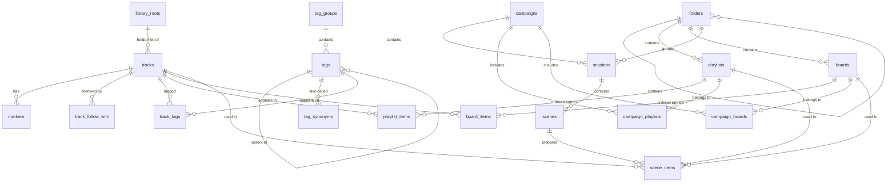

# Data model

The library database added in WP3 (backlog DAT-6, DAT-1, DAT-2, DAT-10, ORG-4, ORG-7, ORG-1, EDT-2). It lives in the main process, in `src/main/data/`. It is not connected to the player yet: the current player keeps its own storage until your existing library is moved across (DAT-9) and the new interface (WP5) uses the database.

## In plain language

### What is stored

- **Your library of tracks.** Every audio file appears once, as a track, whether or not it is in a playlist. A track keeps the label you give it and, if you fill them in, its scoring details: energy (1 to 5), how it develops (builds, steady, swells, resolves), what it is for (sting, loop bed, underscore, transition), whether it can loop, how it ends, its usual way in and out, what should follow it, notes, composer, album and cue number, your rating and when it was last played.
- **Markers** inside a track: a time, a kind (plain marker, loop in, loop out, mix out) and a label such as "swell".
- **Tags in groups.** Mood, Leitmotif, Scene type, Location and Faction are there from the start, with Melancholy, Heroic, Tense, Wistful, Warm, Triumphant and Eerie under Mood. You can rename, reorder, merge or delete any of them. A tag can sit under another (Leitmotif › Villain › Strahd) and can have other names ("sad" finds Melancholy).
- **Playlists and soundboards.** They point at tracks in the library. One track can be in many playlists and on many boards; edit its label once and it changes everywhere. Each sound on a board keeps its own loop, volume and fade settings. Both can hold dividers with a heading.
- **Folders** for playlists, soundboards and sessions, inside each other as deep as you like, with a colour and an open/closed state.
- **Campaigns, sessions and scenes.** A campaign holds sessions, a session holds scenes. Playlists and boards can belong to several campaigns at once; the library and the tags are shared by all campaigns. A scene can list the playlists, boards and tracks prepared for it.

The audio files themselves are not copied: they stay where they are, and each track remembers where its file is. You can name a library folder (for example "Soundtracks" = `H:\Audio\Soundtracks`). Tracks inside it are then remembered relative to that folder, so if you move it to another drive, one change to the folder fixes every track in it. Each track also remembers the file's size, date and (when known) a fingerprint, so missing files can be found again later (DAT-8).

Deleting a playlist or a board never deletes tracks. Deleting a track takes it out of every playlist, board and scene; the interface will show where it is used and ask first.

### Where it is

| What | Where on Windows |
| --- | --- |
| The library | `%APPDATA%\cue-desk\library\library.sqlite` |
| Working files of the library, present while Cue Desk runs | `library.sqlite-wal`, `library.sqlite-shm` next to it. They are part of the library: do not delete them. |
| Backups | `%APPDATA%\cue-desk\library\backups\` |

### Backups

- **Daily:** the first time Cue Desk runs on a day, it makes a copy, and while it stays open it checks every hour whether a new day has started. The newest 14 daily copies are kept.
- **Back up now:** a button in the new interface makes a copy at once. The newest 14 of these are kept, separately from the daily ones.
- **Before an upgrade:** when a new version of Cue Desk changes the library format, it copies the library first.

Every copy is checked before it counts, so a half-written copy is never kept as a backup. Names show the kind and the time, for example `library-daily-2026-11-04T12-00-00-000.sqlite`. Other files you put in the backups folder are left alone.

### If the library file is damaged

Each time Cue Desk opens the library it checks the whole file. The check runs alongside start-up, so it does not slow the app down. If the file is damaged, Cue Desk says so in plain words and offers to put back the newest backup that passes the same check. The damaged file is kept, renamed `library-damaged-<time>.sqlite`, in case it is needed.

### Undo

Every change to the library, tags, folders and campaigns can be undone and redone, including deletes and changes that touch many tracks at once (for example merging two tags). The last 100 steps are kept while Cue Desk is open; the history starts empty each time it starts. Marking a track as "last played" is not an undo step.

### Upgrades

A newer version of Cue Desk may add to the library format (cue lists and pads come this way, once their design is chosen). The upgrade happens by itself when the new version starts, after the backup above. If an upgrade fails, the library stays exactly as it was. A library saved by a newer Cue Desk is not opened by an older one, so it cannot be damaged by it.

### How fast it is

Measured with 20,000 tracks and 500 playlists of about 80 tracks each (a 43 MB library) on the 2-core build machine: opening takes about 12 ms, a search 0.03 to 15 ms, a single edit under 0.3 ms, an edit plus its undo about 1 ms, the full integrity check about 310 ms (alongside start-up) and a backup about 0.5 s.

## Technical reference

### Module layout

| File | Purpose |
| --- | --- |
| `sqlite.ts` | Loads `node:sqlite` (decision D3) without its experimental warning; `openConnection()` turns on foreign keys, recursive triggers and, for files, WAL with `synchronous = NORMAL`. |
| `schema/migrate.ts`, `schema/index.ts`, `schema/v001-initial.ts` | Numbered schema versions, the upgrade runner and `rebuildTable()`. |
| `store.ts` | `Store`: cached prepared statements, injected clock, `change(label, fn)` (one transaction, one undo step) and `changeWithoutHistory(fn)`. |
| `ordering.ts` | Gap ordering (`positionFor`, `positionsFor`). |
| `paths.ts` | Paths relative to library roots, for Windows and POSIX paths. |
| `validate.ts`, `errors.ts`, `types.ts` | Input checks, error classes, shared types. |
| `repo/*.ts` | Repository functions: `roots`, `tracks`, `markers`, `folders`, `playlists`, `boards` (both built on `containers`), `tags`, `campaigns`, `search`. |
| `undo.ts` | `UndoHistory`. |
| `integrity.ts`, `backups.ts`, `library.ts` | Integrity check, backups, `openLibrary()`, `restoreBackup()`, `startDailyBackups()`. |
| `index.ts` | Public exports for WP5. |

Nothing in the module imports Electron. The main process will call `openLibrary({ folder: libraryFolder(app.getPath("userData")) })`.

### Opening

`openLibrary()`:

1. Creates the folder; opens `library.sqlite`. A file that is not a database fails here with `LibraryDatabaseError` code `corrupt`.
2. Existing file: reads the schema version. If an upgrade is pending, or `integrityCheck: "blocking"` was asked for, runs `PRAGMA quick_check` now and backs up before upgrading.
3. Runs pending upgrades (`migrate`).
4. Creates the `Store` and the `UndoHistory` (temporary triggers).
5. Otherwise starts `quick_check` on a worker thread (an eval worker with its own read-only connection, so no extra webpack entry). `checkIntegrity()` resolves to `{ status: "ok" }`, `{ status: "corrupt", error }` or `{ status: "not-checked" }` (closed first); it never rejects.

`error.latestBackup` is the newest backup that passes `quick_check`. `restoreBackup({ folder, backupPath })` accepts only a file from the library's own backups folder, renames the damaged file (and its `-wal`/`-shm`) to `library-damaged-<time>.sqlite`, and copies the backup in place through a `.part` file. The library must be closed first.

### Tables

Conventions: text ids (UUIDs; ids from the current Redux data can be kept); times in milliseconds since 1970 UTC; durations and marker times in milliseconds; `position` is a REAL order key. Lists of choices (arc, role, folder scope, item kind …) are checked in the repository, not by CHECK constraints, so a later version can add a choice without rebuilding a table. Fixed ranges (energy and rating 1–5, volume 0–1, times ≥ 0) are also CHECK constraints.

| Table | Holds | Notes |
| --- | --- | --- |
| `schema_migrations` | Applied versions | Also mirrored in `PRAGMA user_version`. |
| `library_roots` | Named library folders | Name unique, case-insensitive. |
| `tracks` | One row per audio file | `root_id` + `path` relative to the root (with `/`), or absolute `path`, or `url`. `file_name`, `file_size`, `file_mtime_ms`, `checksum` for relinking. DAT-2 fields; `transition_in`/`transition_out` are JSON (`Transition` in `types.ts`). |
| `track_follow_with` | Ordered "follow with" links | WITHOUT ROWID. |
| `markers` | Time, kind, label per track | |
| `folders` | Nested folders | `scope`: playlists, boards or sessions. |
| `playlists`, `playlist_items` | Manual playlists and their entries | Entry `kind` track or divider. |
| `boards`, `board_items` | Soundboards and their entries | Entry `kind` sound or divider; `loop`, `volume`, `fade_in_ms`, `fade_out_ms` per entry. |
| `tag_groups`, `tags`, `tag_synonyms`, `track_tags` | Tag vocabulary and tagging | Tag names unique per group; synonyms case-insensitive. |
| `campaigns`, `sessions`, `scenes` | ORG-7 hierarchy | Sessions may sit in a folder. |
| `campaign_playlists`, `campaign_boards` | Membership in several campaigns | WITHOUT ROWID. |
| `scene_items` | Playlists, boards or tracks prepared for a scene | Exactly one of the three ids. |
| `search_docs`, `search_fts` | Search index | Written only by triggers. |

Deletes: removing a playlist, board, scene or campaign removes its entries and memberships, never tracks (ON DELETE CASCADE on the entry tables only). Removing a track removes its entries, tags, markers, links and scene items. A library root in use cannot be deleted by SQL (RESTRICT); `removeRoot()` first turns its tracks' paths into absolute paths. `deleteFolder()` moves subfolders and items up one level; ON DELETE SET NULL is only a safety net.

### Ordering

Rows in a hand-ordered list are `GAP` (1024) apart. Inserting or moving takes the midpoint between the neighbours, so only the moved rows change. When a gap can no longer be split (after about 50 moves into the same place), that one list is renumbered inside the same change and undo step. `positionsFor()` spreads a block of new or moved rows evenly across the gap, keeping their order. Placements: `"start"`, `"end"`, `{ before: id }`, `{ after: id }`.

### Search

`search_fts` is an FTS5 table (`unicode61`, diacritics removed, prefix indexes of 1–3 characters) with columns title, file name, tags (names and synonyms), markers (labels), notes and source (composer, album, cue number). Each searchable row has a `search_docs` row whose `doc_id` is the FTS rowid. Triggers in schema version 1 keep both current for tracks, tag renames and synonyms, tagging, markers, playlists, boards, campaigns, sessions and scenes.

`search(store, text, { kinds, playlistId, boardId, limit })` turns each typed word into a quoted prefix term (FTS5 syntax typed by the user is plain text), requires all of them, and ranks by BM25 with weights title 10, tags 6, file name 4, markers 3, source 2, notes 1.

### Undo

`UndoHistory` creates TEMP triggers (never stored in the file) on every ordinary table except `schema_migrations` and `search_docs`. While `store.change()` runs, they note each inserted key, each deleted row and each update's old and new values (as JSON, which keeps REAL values exact) in `temp.undo_capture`; cascaded deletes and SET NULL updates are noted the same way. On commit the notes become one labelled step; updates keep only the columns that changed. `undo()` applies the opposites newest first in one transaction with `PRAGMA defer_foreign_keys = ON`, and what that replay changes is noted as the redo step. A failed undo rolls back and keeps the step. Default limit 100 steps; `clear()` empties the history (for example after a bulk import). Changes made with `changeWithoutHistory()` are not recorded.

Triggers are built from the tables present at open, so tables from later versions are covered automatically, provided each has a primary key.

### Upgrade procedure (adding version N)

1. Add `schema/vNNN-<name>.ts` exporting a `Migration` with `version: N` and a short `name`, and append it to `MIGRATIONS` in `schema/index.ts`. Never edit a released step.
2. In `up(db)`: plain `CREATE TABLE`, `CREATE INDEX` and `ALTER TABLE … ADD COLUMN` statements. For anything ALTER TABLE cannot do (new constraint, changed or dropped column), use `rebuildTable(db, table, columnDefinitions, copiedColumns)`, which drops and recreates all triggers around the swap.
3. Each step runs in its own transaction with foreign keys paused; `PRAGMA foreign_key_check` must be empty before it commits. A failing step rolls back and the error names it.
4. New searchable tables need search triggers (see `simpleDocTriggers` in `v001-initial.ts`; copy the SQL into the new step rather than importing it, so the old step stays frozen).
5. Every new table needs a primary key (undo depends on it).
6. Write a test like `schema/migrate.test.ts` "upgrades an old database to a later version and keeps every row": build a version N−1 database with data, upgrade, check the old rows and the new tables.

`openLibrary()` backs the library up (`library-upgrade-v<N−1>-…`) and runs a blocking integrity check before upgrading.

### Bringing in the current player's data (DAT-9, next stream)

| Redux (`persist:player`) | Database |
| --- | --- |
| `playlists.tracks[id] = { id, url, title }` | `tracks` with the same id; a file path becomes `file.path` (under a library root when one matches), an `http(s)` address becomes `url` |
| `playlists.playlists.byId[id] = { id, title, background, tracks[] }` | `playlists` with the same id and background text; `tracks[]` order becomes `playlist_items` |
| `playlists.playlists.allIds` order | `playlists.position` |
| `soundboards.sounds[id] = { id, url, title, loop, volume, fadeIn, fadeOut }` | a track (same id) plus a `board_items` sound entry with `loop`, `volume`, `fade_in_ms = fadeIn`, `fade_out_ms = fadeOut` |
| `soundboards.soundboards.byId[id]` | `boards` with the same id, background and order |

`repo/kenkuShape.test.ts` shows this mapping with today's Redux types. The import should run inside one `changeWithoutHistory()` and then `history.clear()`.

### Tests

| File | Covers |
| --- | --- |
| `schema/migrate.test.ts` | New database, default vocabulary, upgrade keeping data, a later version adding cue lists and pads, failed step rollback, table rebuild, newer-version refusal. |
| `ordering.test.ts`, `paths.test.ts` | Gap ordering and renumbering; root-relative paths. |
| `repo/*.test.ts` | Every repository function, input checks, library-first deletes, the Redux mapping, search. |
| `undo.test.ts` | Every write command undone and redone against full snapshots of all tables and the search index; a guard that fails when a new write function is missing from that list. |
| `library.test.ts` | Open, upgrade backup, damaged files (blocking and background check), restore, daily/manual backups and pruning, the hourly timer. |
| `performance.test.ts` | The 20,000-track targets. `CUE_DESK_SKIP_PERF=1` skips it; `CUE_DESK_PERF_REPORT=<file>` writes the measured numbers. |

### Not in version 1

Cue lists, pads and cue actions (WPD, PLY-8), dynamic playlists (ORG-6), embedded file tags (DAT-5), export/import (DAT-7) and relinking (DAT-8) arrive in later steps. No IPC channels exist yet; they will be added with the interface and listed in `docs/security.md`.
