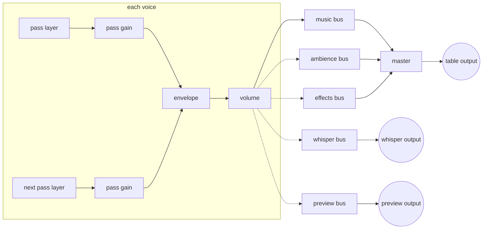
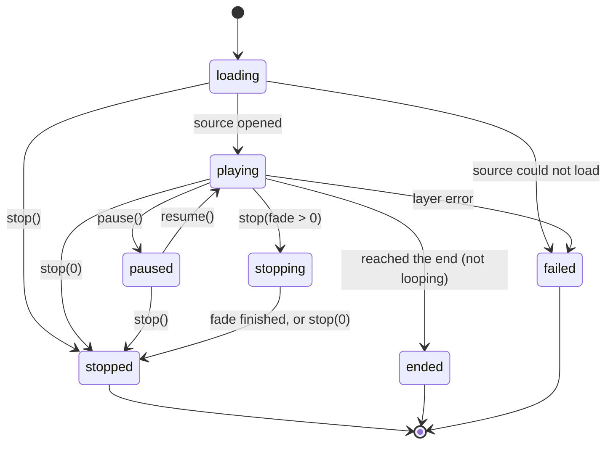

# Playback engine (WP4)

The new playback engine lives in `src/player/engine`. It is built and tested but not yet used by the player's screens: WP5 connects the new interface to it. Until then the player keeps playing through Howler as before.

## For the product owner

### Channels you can mix

Everything you play goes into one of five channels, called buses. Each bus has its own volume slider and mute button.

| Bus | What it is for | Who hears it |
| --- | --- | --- |
| Music | Playlists and tracks | The table (Discord) |
| Ambience | Rain, tavern noise, long loops | The table (Discord) |
| Effects | Stings, door slams, pads | The table (Discord) |
| Whisper | Something for one player you have taken aside | Only the private room (later, OUT-5) |
| Preview | Trying out the next track or a pad in your headphones | Only you (later, PRV-1) |

Music, ambience and effects are added together and pass through the master slider. The result is the table mix, which is what the main Discord room hears. Whisper and preview never pass through the master and are never added to the table mix. That separation is built into how the audio is wired, and an automated test plays a tone into the preview and checks the table mix stays silent.

The whisper and preview buses exist now, but nothing sends them anywhere yet. Today Discord receives whatever the player page plays out loud, so the private paths need their own route before they appear on screen. OUT-5 adds a second stream to Discord for the whisper; PRV-1 sends the preview to your headphones from a part of the app that Discord does not record. Until those are done, the new interface will only offer the three table buses.

### Fade everything, stop everything

"Fade all" fades every playing item to silence over a number of seconds you choose, then stops them. The sliders stay where they were, so the next thing you play is heard straight away. It can leave the preview playing. "Stop all" silences everything at once, including anything still fading or loading. The Panic button in the cue list (SHW-2) will use the first on one press and the second on the next.

### Long files and memory

Long tracks are played straight from the file, a little at a time, so an hour of ambience uses no more memory than a minute of it. Short sounds that must start instantly (pads) or loop without a gap are read whole into memory once and kept for reuse. Only files under 6 MB that last under 30 seconds are kept this way, and the kept sounds share a 200 MB limit; when it is reached, the sounds you used longest ago are dropped first. Kenku FM read every sound without fades whole into memory, about 23 MB per stereo minute.

### What is fixed in the engine

- Deleting a track from a playing playlist no longer changes which track is current (BUG-11). The old player still has this bug until WP5 switches it over.
- Looping sounds release everything when they stop or loop, checked over 1,000 start/stop cycles and 500 loop passes (BUG-4).
- Jumping to another point in a sound moves its fade-out and its next loop with it (BUG-5).
- Nothing checks the time 60 times a second. The engine reports changes as they happen, and the progress bar is updated once a second only while something plays (PERF-1).
- A track missing from the library is skipped instead of stopping "next" from working.

### Manual checks

None yet: the engine has no screen. Once WP5 connects it, the checks are listed with that work.

## Technical design

### Modules

| Path | Contents |
| --- | --- |
| `queue/queue.ts` | Queue state and rules as pure functions: next, previous, track end, repeat, shuffle, insert, remove, move. No browser APIs. |
| `queue/queuePlayer.ts` | Plays a queue through the engine on one bus; moves on when a voice ends. |
| `graph/mixer.ts` | Buses, master, outputs. |
| `voice/voice.ts` | One playing item: volume, fades, loops, seek, pause, stop, release. |
| `sources/layers.ts` | One play-through of a decoded buffer (`BufferLayer`) or a streamed media element (`StreamLayer`). |
| `sources/sourceLoader.ts` | Resolver, stream-or-decode decision, size and length limits. |
| `sources/bufferCache.ts` | Decoded buffers, LRU with a memory cap and leases. |
| `sources/readBytes.ts` | Reads small files with XMLHttpRequest, giving up past a size limit. |
| `engine.ts` | `PlaybackEngine`: mixer plus voices, fade all, stop all, events, progress ticker. |
| `browser.ts` | `createBrowserEngine()`: the engine with a real `AudioContext`, `<audio>` elements and XHR. |
| `audio/types.ts` | The small structural types for Web Audio and media elements that the engine uses, so tests can pass fakes. |
| `testing/` | Fake audio context and clock, seeded random. |
| `testHook.ts` | Test builds only: `window.__cueDeskEngineTest` for `e2e/engine.spec.ts`. |

Everything that touches time or randomness takes it as a parameter (`Scheduler`, `Random`), and every Web Audio call goes through `EngineContext`. The unit tests run whole sessions in milliseconds with `testing/fakeAudio.ts`.

### Graph

A voice connects to exactly one bus. The pass gains hold the fade-in, the fade before the end and the loop cross-fade; the envelope holds stop fades and fade all; the volume gain holds the item's own volume. Keeping them apart means a volume change during a stop fade does not cancel the fade. Bus and master levels are a single gain each (level, or 0 when muted) and move over 20 ms to avoid clicks. `mixer.levels()` and `mixer.restore()` save and bring back every fader for layouts and scenes.

### Forming the broadcast mix

The table mix is music + ambience + effects through the master, available as `engine.outputs.table`. Whisper and preview have their own outputs, `engine.outputs.whisper` and `engine.outputs.preview`. The mixer never connects an output to anything; the host page does, and the rule is:

- In the player page, which Discord captures as a whole (`chromeMediaSource: "tab"` in `AudioCaptureManagerPreload.ts`), only `outputs.table` may be connected to `audioContext.destination`.
- OUT-5 takes `outputs.whisper` as a separate stream (for example through a `MediaStreamAudioDestinationNode` handed to the capture side), so the main room and the private room get distinct streams.
- PRV-1 plays `outputs.preview` somewhere tab capture does not record. Options to evaluate there: a `MediaStreamAudioDestinationNode` played by an element with `setSinkId` in another, uncaptured page, or the capture window's own context. Connecting it to the player page's destination would broadcast it.

### Voice states

`stopped`, `ended` and `failed` are final. All three go through one `finish()` step that clears the voice's timers, releases every layer (buffer sources stopped and disconnected; media elements paused, their `src` removed and `load()` called, listeners removed), disconnects every gain and gives the source's cache lease back. `errorMessage` is filled in before the `failed` state is reported.

### Passes, fades and loops

A pass is one play-through. With `fadeOutSeconds > 0` the pass fades out that long before its end; for a loop, the next pass starts at the same moment and fades in over `fadeInSeconds`, so equal fade lengths overlap at a constant level. The cross-fade is limited to half the sound's length. Without a fade-out a loop is played natively: `AudioBufferSourceNode.loop` (gapless) or `<audio loop>`.

Timing uses one timer per fade point, never polling. The timer fires a little before the fade point (0.25 s for buffers, 1.5 s for streams) and prepares the next pass. A buffer pass is started with `start(when)` on the exact sample; a stream pass is opened early and started at the fade point. A second timer at the fade point hands over: the old pass becomes the outgoing pass and is released when it ends, or at the latest 0.5 s after its fade should have finished. The next pass is prepared only after the outgoing one is gone, so a voice never holds more than two passes.

Seek, pause, resume and switching the loop cancel any prepared pass, drop the outgoing pass, put the current pass back at full level and re-arm the fade point from the new position (BUG-5). Time spent paused is not counted. Pausing a buffer pass stops its source node and starting again makes a new one, since a source node can only be started once.

### Sources

`engine.play({ bus, media: { url } })` passes the address through `SourceLoader`:

1. `MediaResolver.resolve(request)` returns the address to play. The default returns it unchanged. PLY-11 (local copy of slow or remote files) and BUG-10 (WMA converted to a cached copy) supply their own resolver that returns a `file://` address of the cached or converted file, with no other engine change. The cache key is the resolved address.
2. Without `preferBuffer` the item streams through a new `<audio>` element and a `MediaElementAudioSourceNode` (one element per pass, as an element can feed only one source node).
3. With `preferBuffer` (pads, and any loop without a fade-out, which needs to be gapless) the file is decoded if it is small: a known size over `maxDecodeBytes` (6 MB) streams without reading; otherwise `readBytes` reads at most that many bytes, a result over `maxDecodeSeconds` (30 s) streams, and a decode failure streams so the media element can try or report. Addresses that failed these checks are remembered and stream directly next time.
4. Decoded buffers go into `BufferCache` (cap `cacheBytes`, 200 MB, counted as samples × channels × 4 bytes). Playing buffers are leased and never dropped; unleased ones go least recently used first. Concurrent requests for one address decode once. `engine.preload()` fills the cache ahead of time.

Small files are read with XMLHttpRequest because Chromium's `fetch()` refuses `file://`; the player's CSP allows `file:`, `https:` and `http:` in `connect-src` and `media-src`. `e2e/engine.spec.ts` confirms both paths in the packaged app: a `file://` WAV streams through a media element with audible output, and a short one is read, decoded and played.

An `http(s)` track from another site will play through an element, but Chromium gives Web Audio silence for media from another origin unless the server allows it (CORS). PLY-11's download-to-cache resolver avoids that by handing back a local copy; until then such tracks should stay on the old player.

### Queue rules

The queue keeps `entries` (the list as arranged), `order` (play order: the list with shuffle off, a shuffled copy with it on) and `currentId`, the current entry's own id. Edits never move the current entry because it is not a position; that is the fix for BUG-11. Entries have ids separate from track ids so a track can be queued twice (PLY-1).

| Action | Repeat one | Position | Repeat off | Repeat all |
| --- | --- | --- | --- | --- |
| Next, or the track ends | restart | not last | play the next in order | play the next in order |
| Next, or the track ends | restart | last | stop, current kept | play the first; when shuffled, a new order is drawn whose first track is not the one that just played |
| Previous, 5 s or more into the track | restart | any | restart | restart |
| Previous, under 5 s | restart | not first | play the previous in order | play the previous in order |
| Previous, under 5 s | restart | first | stop, current kept | play the last in order |
| Any, when the target is the current entry (one-entry queue) | restart | | restart | restart |
| Any, empty queue | stop | | stop | stop |

| Edit | Shuffle off | Shuffle on |
| --- | --- | --- |
| Turn shuffle on | | current entry first, the rest shuffled |
| Turn shuffle off | play order becomes the list; current kept | |
| Remove an entry that is not current | current kept | current kept; the rest of the play order unchanged |
| Remove the current entry | the next in play order becomes current (wrapping only with repeat all; none otherwise) | same |
| Move an entry | play order follows the list; current kept | list changes, play order unchanged |
| Insert "next" | straight after the current entry in list and play order | same |
| Insert "end" | at the end of list and play order; first entry becomes current in an empty queue | same |

Shuffling never puts two entries of the same track side by side, and never starts with the track that just played, unless nothing else is left (for example one track queued three times). The repeat names map from the old player as track → one and playlist → all. Repeat one restarts on next and previous as well, as the old player did; that is a candidate for review in WP5.

`QueuePlayer` applies these outcomes to voices: a voice's `ended` event triggers the track-end rule; next and previous cross-fade over 1 s (Kenku FM's fixed value, now a constructor option); a track missing from the library is skipped; a track that fails stops playback with "Unable to play track: <title>"; removing the playing entry stops it.

### Events and progress

`PlaybackEngine` emits `voice` (a voice and its new state) and `voice-error` (a voice and a message; named so because Node's `EventEmitter` throws on an unheard `error`). Voices emit `state`, `loaded` (length in seconds), `ended` and `error`. Positions are read on demand with `voice.position()`. `engine.onProgress(listener)` reports every voice's position once a second; its timer exists only while there is a listener and something is playing, so an idle player runs no timers at all.

### Tests

Unit tests are listed in `docs/testing.md` > Playback engine tests; the real-browser check is `e2e/engine.spec.ts`. Test builds expose `window.__cueDeskEngineTest` (start, play an address on a bus, listen to the music bus and each output with AnalyserNodes, stop all, close). `webpack.renderer.config.js` defines `__CUE_DESK_TEST_BUILD__`, and release builds compile the hook and the engine out until WP5 imports it.

### Left for later

- WP5: connect the interface; then turn QUEUE-1 in `playlistPlaybackSlice.test.ts` into a normal test or retire it with the old slice, and port the characterisation cases that still apply.
- OUT-5 and PRV-1: the separate routes for the whisper and preview outputs described above.
- PLY-8: equal-power cross-fades and transitions such as "start after the current loop" (fades are linear today).
- PLY-4: loop markers (DAT-3) and per-track "remember position".
- PLY-11, BUG-10: resolvers for the local file cache and format conversion; one memory budget shared with `BufferCache`.
- PERF-1's idle CPU figures: the old animation loops were removed from the current player in wave 1 (WPL), but the before/after effect is recorded only as timer wake-up counts (`docs/testing.md`, Current player fixes), not as CPU. Measuring CPU idle before and after is still to do, by hand on Windows.

## Wave 2: the show engine

### For the product owner

The engine now plays a game the way the design prototype does. Nothing on screen uses it yet; the new interface (wave 3) will.

- **Scenes play their music in order.** Starting a scene plays its first music item, then each track and each playlist's tracks in turn, and starts again at the end. A track never plays twice in a row. Next and Previous move through the same order. The scene's ambience (a track, or the first track of an ambience playlist) loops on the ambience channel; Next on the ambience moves through its playlist.
- **Audio profiles are heard.** Each track plays from its Start to its End, with its fade in and fade out shaped as set (gentle, even or sharp), and at End it loops back to Loop start (with the loop crossfade), moves on, or stops. A scene's own settings for a track win over a playlist's, which win over the track's own. The volume changes are written ahead on the audio clock, so a fade or an End lands on the exact moment, not "about then".
- **Now Playing.** Play now crossfades (3 s). Play next waits for the current track to end, before the scene moves on; queued tracks can be removed. A track played off script returns to the scene at the next step once it ends. Undo after starting a scene brings back the previous music and ambience where they would be now, with the queue (the screen offers it for 8 seconds).
- **One set of actions for everything.** Play a track or playlist, start a scene, next or previous, fade a channel, fade everything, stop everything, fire a pad: the buttons, the keys and later the Stream Deck all send the same action, which names the room it plays in (or all rooms). Scenes always start in the first room.
- **Track roles.** With no profile saying otherwise, a loop bed loops, a sting or a transition plays once and hands over to what comes next, an effect plays once, and anything else follows its loop advice. Ambience always loops; effects play over the music.
- **Pads**: one-shot (presses overlap), toggle (on, then off; per room), hold (while held), retrigger (cuts the last one), with variants at random or in turn.
- **BUG-11** stays fixed here too: removing tracks from a scene or playlist while it plays never changes the track that is playing, and Next and Previous go to its neighbours.

What it does differently from the prototype, on purpose: when a track reaches End the next one starts without an extra 3 s fade (the prototype faded every change in), because the track's own fade out and the next one's fade in shape the join. Undo restores only the room the scene started in.

### Technical design

| Path | Contents |
| --- | --- |
| `queue/actions.ts` | `CueAction` (plain data), `CueOutcome`, default fades, `isCueAction` for actions from outside. |
| `queue/director.ts` | `Director`: `run(action)`, `report()` (what each room plays), `canUndo()`; one `RoomPlayer` per room; drops rooms that leave. Events `change` and `error`. |
| `queue/roomPlayer.ts` | Music lane, ambience lane, effects and pads of one room; snapshot and restore for Undo. |
| `queue/nowPlaying.ts` | Pure rules: `playNow`, `queueNext`, `removeQueued`, `advance`, `previous`, `upNext`, `stepFrom`, `locate`. |
| `queue/library.ts` | `ShowLibrary` (domain lookups, a track's media, a pad's sound) and `staticLibrary(data)`. |
| `profile/trackProfile.ts` | `trackProfile` (resolveProfile plus role defaults), `laneProfile` (ambience loops, effects once). |
| `profile/position.ts` | Where a track would be after some time, for Undo. |
| `voice/passPlan.ts` | A pass's start, End, loop point, overlap and gain: `plainPlan` (the WP4 options) or `profilePlan` (an audio profile via `envelopeAt`). |
| `rooms.contract.ts` | `RoomsAudio`, the interface to the Rooms stream; `tableOnlyRooms`. |

A voice given `profile` plays passes from Start (or `startAt`) to End. When a pass starts, its gain is written on the timeline: `envelopeAt` sampled into straight ramps (24 per curved stretch, two points for a straight one), a straight loop crossfade, and 0 at End when End is inside the file. A timer at End ends the voice (after "next" or "stop") or, for a loop, a timer shortly before End minus the crossfade opens the next pass from Loop start, started on the exact sample for decoded audio. Seek, pause and resume re-write the gain from the new position. `crossfadeInSeconds` fades the whole voice in on its envelope gain, separately from the profile. Without a profile a voice behaves exactly as in WP4.

`engine.play` takes `room: { id, input }` to play into a room's bus instead of its own; the director gets the input from `RoomsAudio.getRoomBus(roomId, lane)`. Lanes are `music`, `ambience` and `effects`.

The current track is an item (`Playing`: track id, origin with its step number, the playlist it came through), never a bare position. `locate` finds it again after the scene or playlist changed: its own step if it still holds the track, else the nearest step with the same track, else (it was removed) the place it was.

### Tests

| Test file | What it covers |
| --- | --- |
| `voice/voiceProfile.test.ts` | Start and End inside the file, shaped fade in and fade out against `fadeInGain`/`fadeOutGain`, loop back to Loop start with and without a crossfade (no second fade in, never quieter, at most two passes), the next pass started on the exact sample, crossfade in, start elsewhere, seek and pause keeping End right, 200 loop passes leaving nothing behind. Streams and buffers. |
| `profile/*.test.ts` | Role defaults, scene before playlist before track, lane rules; Undo positions. |
| `queue/nowPlaying.test.ts` | Scene order without repeats, wrap, previous; queue before the sequence; off-script return point; "stop" still plays the queue; BUG-11 deletions before, at and around the current track. |
| `queue/director.test.ts` | On the fake graph with fake rooms: scenes, profiles heard per room, ambience looping, Next/Previous, Play now and Play next, Undo, rooms and targets, fade lane, fade all, stop all, pads, stings and loop beds, failing files, BUG-11 while playing, `isCueAction`. |

The test hook (`window.__cueDeskEngineTest`, test builds only) gained `loadShow(data)`, `run(action)`, `rooms()` and `errors()`, so end-to-end tests can drive the show and see what each room plays.

### Manual checks

None until the new interface uses the show engine; the wave 3 screens will list them.

### Left for later

- Pause and resume of a lane as an action (the prototype's pause button), and shuffle within a scene.
- Starting the next track a little before End to hide the time a streamed file takes to open (a short gap is possible today).
- Undo for other rooms, and an Undo for actions other than a scene start.
